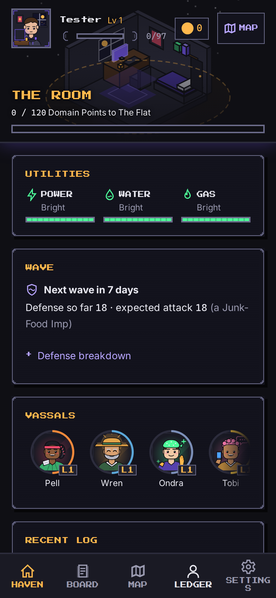
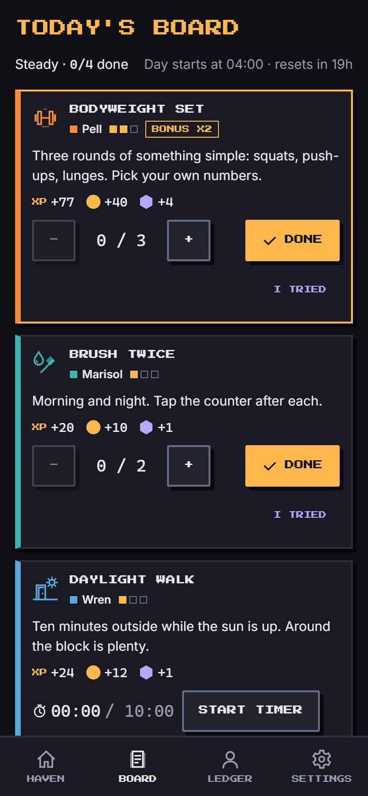
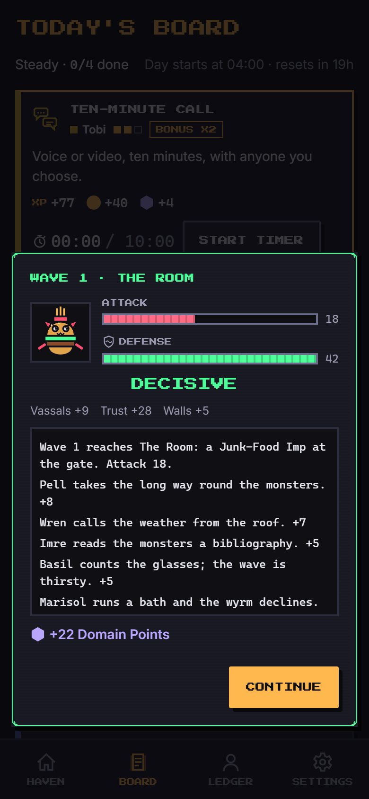
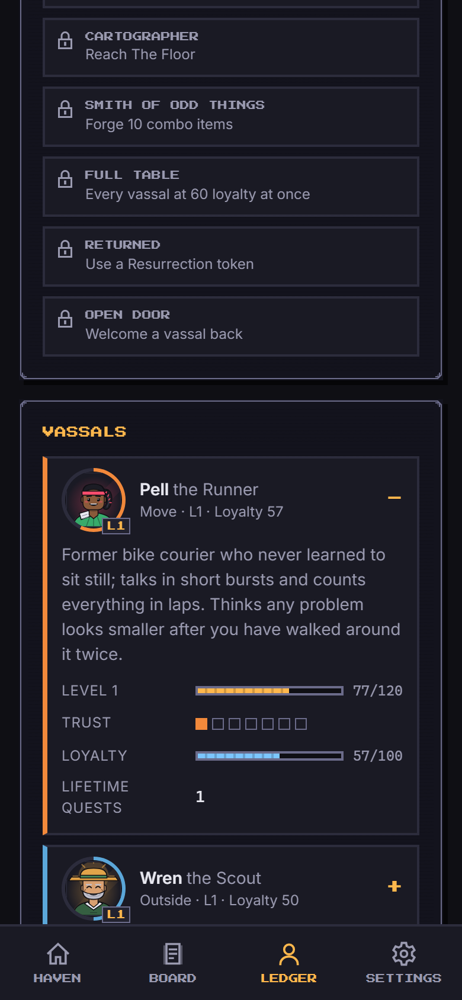
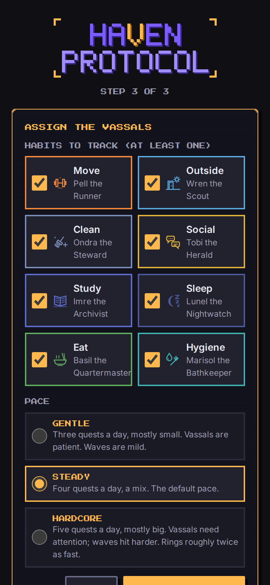
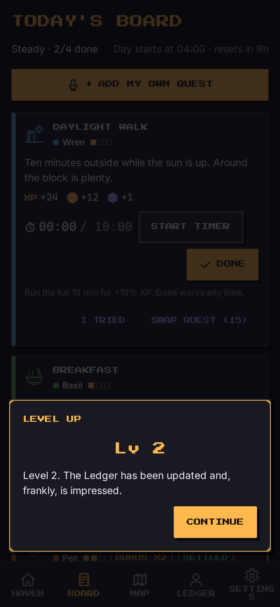
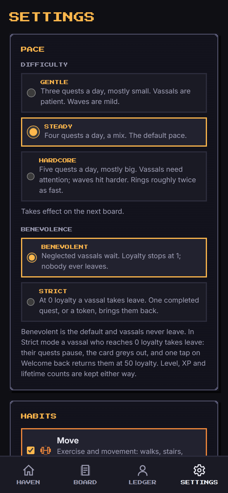
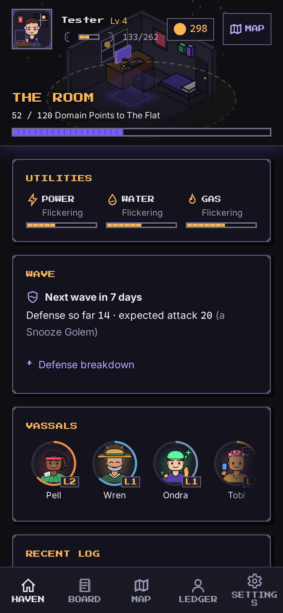

<p align="center">
  
</p>

<p align="center"><strong>Go out. Come home. The Haven grows.</strong></p>

**Haven Protocol** is a mobile-first habit RPG that runs in your browser and installs like an app. You are the Absolute, who keeps the books of a tiny fortress called the Haven. Eight vassals go out into the real world on your behalf: one for moving, one for daylight, one for chores, and so on. Each real-life thing you do (and honestly report) earns XP, settlement and loyalty, and the Haven grows ring by ring from one room to a whole city. It works offline, has no backend, no accounts and no analytics, and it never punishes you: the Haven never falls.

> Unofficial, fan-inspired project. See [Non-affiliation](#non-affiliation).

## How it plays

- **Vassals.** Eight habit tracks (Move, Outside, Clean, Social, Study, Sleep, Eat, Hygiene), each with a vassal who levels up, earns your trust through the week and has a loyalty meter.
- **Daily board.** Each game day (default reset 04:00) the Protocol issues 3 to 5 quests from your enabled habits. Tap Done, run an optional timer, or count up. The hardest quest is a double-reward bonus contract. "I tried" counts for trust. Undo and a once-a-day swap are there when you need them.
- **Settlement.** Every completion pays XP, coins ("settlement"), Domain Points and loyalty, with the amounts shown in a short report you can undo the same day.
- **Utilities.** Power, Water and Gas are fed by Sleep, Hygiene and Eat. They fade a little when neglected and are purely mood plus a wave bonus: an Out utility costs nothing.
- **Weekly wave.** Every 7 days a wave of silly monsters (Dust Bunny, Doomscroll Wyrm...) attacks. Your week's effort, vassal levels, walls, titles and forged combo items are the defense. A win pays more Domain Points; a "loss" still pays and takes nothing away.
- **Rings.** Domain Points push the boundary outward through seven rings (The Room, The Flat, The Floor, The Building, The Block, The District, The City). Each ring unlocks facilities, harder quests, a story vignette and a bigger wall.

New here? Read the [Player guide](docs/PLAYER-GUIDE.md).

## Screenshots

Captured by the Playwright end-to-end suite (`npm run e2e`) on a 390x844 mobile viewport.

| Haven | Board | Wave result | Ledger |
| --- | --- | --- | --- |
|  |  |  |  |

| Onboarding | Level up | Settings | Home after a week |
| --- | --- | --- | --- |
|  |  |  |  |

## Quick start

Requires Node 20 or newer (CI runs Node 24).

```sh
npm install
npm run dev        # http://localhost:5173
```

To try it on your phone over the local network, see [docs/DEPLOY.md](docs/DEPLOY.md#running-on-a-phone-over-your-lan).

## Scripts

| Script | What it does |
| --- | --- |
| `npm run dev` | Vite dev server with HMR (listens on all interfaces) |
| `npm run build` | Typecheck, then production build to `dist/` |
| `npm run preview` | Serve `dist/` locally with the service worker enabled |
| `npm test` | Run the unit tests once (vitest) |
| `npm run test:watch` | Vitest in watch mode |
| `npm run lint` | ESLint |
| `npm run typecheck` | `tsc --noEmit` |
| `npm run icons` | Regenerate the PWA icons from the SVG mark |
| `npm run e2e` | Playwright end-to-end suite (builds, then serves `dist/` on port 4273; run `npx playwright install chromium` once) |
| `npm run e2e:ui` | Playwright in interactive UI mode |

## Project layout

```
.github/workflows/   ci.yml (every push and PR), deploy.yml (GitHub Pages on push to main)
e2e/                 Playwright end-to-end tests
docs/
  design/            GDD.md (rules), GDD-errata.md (where code departs), ART.md, CITY-MAP.md
  research/          source-analysis.md (research and IP note)
  review/            engine-review.md
  ARCHITECTURE.md  DEPLOY.md  PLAYER-GUIDE.md  ORCHESTRATION.md
public/              favicon.svg, icons/ (PWA icons)
scripts/             gen-icons.mjs, gen-logo.mjs
src/
  assets/            SVG art: habits, haven, logo, monsters, outposts, ui, vassals
  components/        shared UI (AppShell, QuestCard, VassalCard, overlays/ ...)
  game/              pure engine, no React; map.ts, mapGeometry.ts, outposts.ts; content/ holds the JSON data, including outposts.json
  hooks/             useGameTick, useNow, useInstallPrompt ...
  pwa/               service worker registration
  screens/           Home (Haven), Quests (Board), Map, Character (Ledger), Settings, Onboarding
  state/             the zustand store (gameStore.ts) and the app clock
  styles/            tokens.css and global.css
  test/              vitest setup and helpers
  utils/             small helpers
```

## Design docs

- [Player guide](docs/PLAYER-GUIDE.md): how the game works, in plain words.
- [Game design document](docs/design/GDD.md) and its [errata](docs/design/GDD-errata.md): the rules and where the implementation reads them.
- [Art guide](docs/design/ART.md): palette, geometry and asset inventory.
- [Architecture](docs/ARCHITECTURE.md): layers, save format, time model, PWA and testing strategy.
- [Engine README](src/game/README.md) and [content schema](src/game/content/schema.md).
- [Deploy](docs/DEPLOY.md) and [Contributing](CONTRIBUTING.md).

## Deploy

CI (`.github/workflows/ci.yml`) lints, typechecks, tests and builds on every push and pull request, then runs the Playwright e2e suite. `.github/workflows/deploy.yml` builds `dist/` and publishes it to GitHub Pages on every push to `main` (it can also be run by hand). The live app is at [https://teddysabatier.github.io/ultimate-shut-in/](https://teddysabatier.github.io/ultimate-shut-in/). The app uses `base: './'` and hash routing, so it works under `/ultimate-shut-in/`. Any static host works too: upload `dist/`. Full steps in [docs/DEPLOY.md](docs/DEPLOY.md).

## Privacy

Everything stays on your device. There is no backend, no account and no analytics. Your save lives in the browser's `localStorage` under the key `haven.save`, and you can export or import it as a JSON file from Settings. The one external request is for the Inter and Press Start 2P fonts from Google Fonts (cached by the service worker after the first load); the game itself works without them using system fonts.

Real-life quests are self-reported on the honor system. The game never asks for a sensor, photo or location.

## Licensing

The repository is split in two:

- **Code** is under the [MIT License](LICENSE). That covers everything that is not listed below, including the game copy in `src/game/content/`.
- **Art** is under [CC BY 4.0](LICENSE-ASSETS): everything in `src/assets/`, `public/icons/` and `public/favicon.svg`. Reuse is welcome with credit.

## Non-affiliation

Haven Protocol is inspired by the Korean web novel and webtoon *Ultimate Shut-in* (집구석 절대자) by Araman. It is an unofficial, fan-inspired project and is not affiliated with or endorsed by the author, Naver Webtoon, or any publisher. No names, art or text from the source are used; the game name, characters, writing and art are original, and the premise of a home base that grows when its keeper's people go out is treated as a genre convention.

## Credits

Built by an orchestrated team of Claude agents (researcher, game designer, engineers, artist, QA, reviewer, technical writer) directed by an orchestrator. Design decisions are logged in `docs/`: [ORCHESTRATION.md](docs/ORCHESTRATION.md), the [GDD](docs/design/GDD.md), its [errata](docs/design/GDD-errata.md) and the [engine review](docs/review/engine-review.md).

Repository: [github.com/TeddySabatier/ultimate-shut-in](https://github.com/TeddySabatier/ultimate-shut-in). Live app: [https://teddysabatier.github.io/ultimate-shut-in/](https://teddysabatier.github.io/ultimate-shut-in/).
