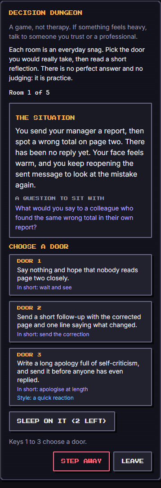
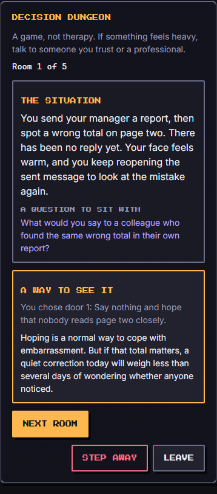
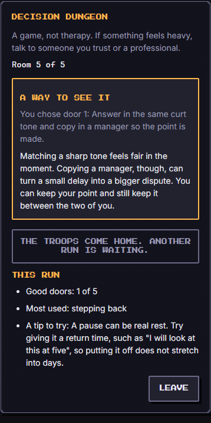

# Decision Dungeon (`decision-dungeon`)

A short practice of choosing a kinder next step in everyday friction. Each room is an ordinary situation: a bus that left a minute early, a blunt message, a form that has sat on the table for days. You pick one of three or four doors, read a warm reflection, and walk on. The monsters are only first reactions in disguise.

**This is a game, not therapy.** It gives no diagnosis, no treatment and no advice about your health, your money or the law, and it cannot tell you anything about who you are. It is a few minutes of practising small ideas (noticing the first reaction, looking at the facts, saying what you can and cannot do, taking one small step). If something in your life feels heavy, talk to someone you trust or to a professional. The game says so on screen, and nothing here replaces that. There are no phone numbers in the game or in this page on purpose.

| Field | Value |
| --- | --- |
| Category | self-development |
| Minimum ring | 1 |
| Roster | 1 to 8 |
| Length | about 4 minutes |
| Languages | English and French (written separately, same structure) |

## How to play

A run is **5 rooms** at difficulty 1 and 2, **6** at 3 and 4, **7** at 5. The rooms are drawn from the seed out of **18 scenarios** (the same 18 structures in English and in French, with their own wording), never repeating one in a game. Easier scenes are walked first, and neighbouring rooms avoid the same mood where they can.

In each room you read a 25 to 50 word situation and pick a door. Each door is one action. Then a 20 to 40 word reflection explains the effect, warmly, never as a verdict (a reactive door starts from "understandable"). **Next room** moves on; the last room says **See the result**.

- **Touch or mouse:** tap a door, then **Next room**.
- **Keyboard:** press `1` to `4` to take that door (the keys are ignored while a field such as the Lab's seed box has focus), or Tab to a door and press Enter. After a choice the focus moves to **Next room**, so Enter keeps you going; at the start of a room the focus moves to the situation so a screen reader reads it first.
- **Step away** ends the run as `fled` through the engine's own leave action and keeps the board on screen with the rooms already walked. **Leave** is a separate button that closes the Screen.
- **Reduced motion:** the room does not fade in; the layout is identical and the game is fully playable (it has no other animation).
- **Accessibility:** every control is a real button of at least 44 px, the reflection is announced in a polite live region, focus is visible, the layout reflows at 150 percent text (checked at 320x568, 390x844 and 844x390), and colours use the dark theme tokens (4.5:1).

### Tags (hidden styles of a door)

A door's style is hidden unless a perk or a hint reveals it. Only the first two count for the score.

| Tag | Meaning | Counts as good |
| --- | --- | --- |
| `constructive` | A small, practical next step that keeps the day moving (send the fix, set a timer, offer two options). | yes |
| `boundary` | Saying kindly what you can and cannot do, or what you need, without blaming anyone. | yes |
| `curious` | Wondering or asking before deciding. A gentle good habit and part of the toolbox; it earns the variety bonus, not the share. | no |
| `avoidant` | Stepping around it: waiting, hiding, dropping it. Sometimes a real rest, so the reflection never shames it. | no |
| `reactive` | Reacting at once while the feeling is hot: snapping, matching the tone, making a show. | no |

Every scenario has three or four doors, **one or two constructive**, never only constructive ones, and always at least one reactive or avoidant door. The constructive door is not always the longest label, the last one, or in the same place: the doors are shuffled by the seed and the source order varies (tests check it).

### Difficulty

`run.difficulty` 1 to 5 changes four things:

- **Plain cues.** At 1 and 2 every door shows a short plain description of the move ("In short: send an update"). From 3 the cue is gone, so the wording is all you have.
- **Subtler rooms.** At 1 and 2 only the gentler scenes are drawn (ease 1 and 2). From 3 at least two of the subtlest scenes (ease 3) join the run, three at difficulty 5.
- **Length.** 5, 5, 6, 6, 7 rooms.
- **The bot** slips more often (below).

### Score and result

Score 0 to 1000, all integers: `floor(900 * good / rooms) + 50 * tools`, where `good` counts `constructive` and `boundary` doors and `tools` counts how many of `constructive`, `boundary` and `curious` you used at least once (practise the whole toolbox). A run of only good doors using both tools scores 1000. Reactive and avoidant doors never add to the score, and one more good door always beats any variety bonus (a test checks it for every possible run of 1 to 7 rooms).

- **Won:** 60 percent good doors or better (`good * 5 >= rooms * 3`, exact integers). The troops come home with a lighter bag.
- **Lost:** under 60 percent. The troops still come home; another run is waiting. Never a punishment.
- **Fled:** you stepped away. The score counts the rooms already answered (0 before the first door); the troops come home early.

`learned` names the style you used most this run (ties go to the good styles) and gives **one tip, phrased as a suggestion**: for a reactive or avoidant habit when that was your most used style, otherwise for the tool you practised least. The Screen shows the same summary after the last room. Tips are in English and French; none is a diagnosis or an order.

## Topics

Ordinary friction only. The 18 scenarios cover:

- transport (a missed bus, a cancelled train)
- work friction (a wrong total, a curt message, a meeting that overruns)
- procrastination (an appointment to book, an inbox pile)
- social situations (a cancelled dinner, a quiet group chat, a lunch you were not part of, a neighbour's favour)
- small failures (a broken glass, a collapsed cake)
- money annoyance (an unknown charge, splitting a bill)
- family logistics (who cooks, the washing-up, two relatives on one Saturday)

**Not in the dungeon:** self-harm, abuse, trauma, medical or legal advice, politics, religion, bereavement, alcohol, diets, debt, or anything else a vulnerable player could find triggering. When in doubt it is left out. `content.test.ts` keeps a keyword guard list for these topics in English and French (and checks that the guard itself catches samples), plus guards against shaming words and "you should", no digits or links in any scene (so no phone numbers), and the "tu" form in French.

## Party

Habits matter, not combat power. The starter party (Move, Outside, Clean) has no perk and is fully playable. When the party has two troops of the same habit, the stronger one counts, and `troopsUsed` lists only the troops whose perk was used.

- **Social** reveals the style tag of **one door** (a seeded random one) in a room. A troop of power 20 or more (level 6 with loyalty 20, for example) does it in **every room**; a weaker one in **every second room** (the first, third, fifth...).
- **Sleep** adds **Sleep on it**: a toggle, then pick a door to read its reflection before you choose. It chooses nothing, works once per room, and is **once per run** for a troop below power 20 and **twice** for a stronger one (listed in `troopsUsed` only when used).
- **Study** shows the room's **reframing question** ("What can you still change in the next twenty minutes?").
- Other habits (Move, Outside, Clean, Eat, Hygiene) and citizens (`habit: null`) give no perk; the game is the same for them.

A level 12 party (power 44) sees a tag in every room and can sleep on two doors; a level 1 party sees a tag every second room and sleeps on one. The bot wins about 67 percent of plain difficulty-2 games with the full party and about 34 percent with the starter party.

## Buffs

- `hint`: each point is one **Reveal a style** press: it shows the style of one more hidden door in the current room (the reveal is seeded).
- `revive`: each point is one **Choose again** after a reflection: the room is picked again and the first answer is dropped from the score.
- `luck`: a gentler dungeon. The hardest room of the draw is swapped for the gentlest unused scene (twice at 30 or more).
- `attack`, `defense` and `time` are ignored on purpose: there is no combat, no incoming damage and no timer.

## Determinism

The room draw uses `mulberry32(fnv1a('decision-dungeon:<seed>'))`, door order `turnRng(seed, 100 + room)`, Social's door `turnRng(seed, 300 + room)`, hints `turnRng(seed, 800 + room * 10 + hintsLeft)` and the bot's slips `turnRng(seed, 900 + room * 10 + revivesLeft)`. Scoring is integer arithmetic. The same seed, party and run give the same dungeon; **English and French draw the same rooms** (the engine keeps the player's language for the log and the learned note, and the Screen reads the wording for that language). No `Math.random`, clock, `navigator` or storage.

## Bot

`botPlay` takes the good door in every room except for a **seeded slip**: the chance of a miss is 46, 58, 63, 68 and 74 percent at difficulty 1 to 5. A style that a perk or a hint revealed helps it (it takes a revealed good door 70 percent of the time), it spends hints first, and it uses a revive when it slipped. It never peeks and never leaves. With the full party on plain difficulty 2 it wins 40 to 70 percent of games (a test checks 200 seeds), less as the difficulty rises.

## Content rules (how to add or change a scene)

- The shape of a scenario (id, mood, topic, ease, and the style of each option in order) lives in `src/games/decision-dungeon/content.ts`. The words live in `texts-en.ts` and `texts-fr.ts`, in the same option order; only the Screen reads them, so the engine stays small.
- Situation 25 to 50 words; reflection 20 to 40 words; 3 or 4 options; one or two constructive; warm, concrete, original; never a shaming word, a topic from the list above, a digit or a link. French is written for French (tutoiement, no gendered adjectives about the player), not translated.
- `content.test.ts` enforces all of it.

## Screenshots

Written by `e2e/games/decision-dungeon.spec.ts` (`shootGame`, mobile project).

| Start | A reflection | The end |
| --- | --- | --- |
|  |  |  |
