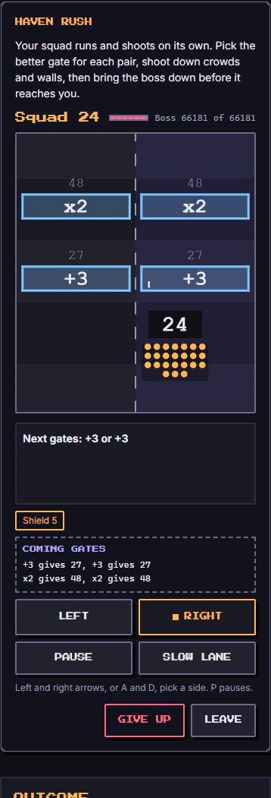
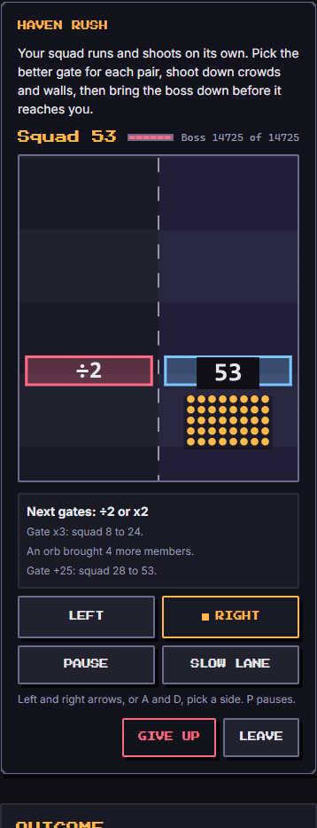
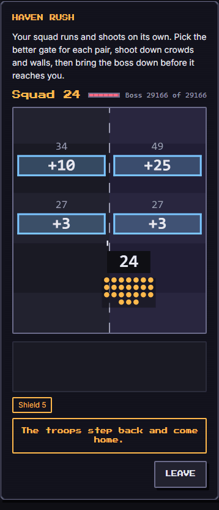

# Haven Rush (`gate-runner`)

A lane runner with maths gates, made fair. Your squad (the habit vassals you bring) runs up a lane on its own and shoots. The lane is split in two halves and ahead of you are pairs of gates (`x2`, `+10`, `-5`, `÷2`, a few `x3` and `+25`): you pick the half that takes the better gate. Crowds and walls cost members, orbs bring some back, and a boss with a big hit point bar must be shot down before it reaches the squad. Every level is built from the seed and **proven winnable** before you see it.

Category `arcade`, minimum ring 1, roster 1 to 8, about 2 minutes (a run is 35 to 50 seconds of lane plus a 7 second boss fight; the rest is reading and the result).

  

## How to play

- **Pick a side.** Left and Right arrows or `A` and `D`, the two **Left** / **Right** buttons, or a tap or a drag on the lane (touch and mouse). The squad slides to that half and stays there. Which gate you take is decided at the instant the squad crosses the gate line, by the half it stands in (the dashed line down the middle counts as the right).
- **Gates.** Applied to the squad count: `x` multiplies, `+` adds, `-` subtracts (a result under 1 empties the squad, the only way a gate can), `÷` divides rounding down and keeps one member while anyone is left.
- **Guards and orbs.** A wall or a crowd drawn right above a gate guards that gate: it is met in the same instant, after the gate has been applied (so `x3` in front of a wall of 30 on a squad of 20 is 60 minus 30). An orb on one side adds members or, once per level, gives rapid fire.
- **Fields.** Between gate pairs a crowd or a wall spans the whole lane, and some orbs: nobody can dodge them, the squad just has to shoot them down in time.
- **Shooting.** The squad shoots by itself every 4 ticks (5 times a second): one point of boss damage per member, plus the attack buff. A crowd or wall in the squad's half within 180 units takes a sixth of that (a wall takes half again: it is armoured). What reaches the squad costs one member per point it has left, and is gone.
- **The boss.** At the end of the lane the squad stops and the boss walks in from 280 units away at 2 units per tick: 7 seconds. Shoot it down before it arrives. If it arrives, the troops come home.
- **Pause** (`P`, Space on the page, or the button; a hidden tab pauses by itself), **Slow lane** (an accessibility assist: the lane runs at half speed, so there is more time to read and to shoot; the boss does not slow down), **Give up** (ends as `fled`), **Leave**.
- **Reduced motion.** No camera shake, no bullets, no floating numbers moving: the lane still scrolls (that is the game), counters still change, the result of a gate is shown in place.

**Result and score.** `won` when the boss dies, `lost` when the squad reaches zero or the boss arrives, `fled` on Give up. Score 0 to 1000: a win is 400, plus up to 300 for the squad left (against twice the squad the proven path brings to the boss, so a strong party is rewarded, never punished), plus up to 200 for how early the boss fell, plus 20 per pickup (100 at most). A loss counts the lane run (150) and the share of the boss taken off (200), plus 10 per pickup (50): up to 399. A retreat counts how far it ran, up to 100. A loss is "the troops come home", never a punishment.

## Party

The starting squad is **5, plus one per member, plus one per 30 points of the party's total power**: a new player's three level-1 vassals start with 8, the full level-12 party with 24. Habits give perks:

- **Move**: the squad slides between the halves faster (10 units per tick, 16 plus the vassal's power divided by 10 with Move), so a late decision still makes it.
- **Social**: a free `+3` gate before the first pair.
- **Study**: the results of the next two gate pairs are shown, on the gates and in a "Coming gates" panel (what each gate would give the squad as it is now; guards are still yours to read).
- **Eat**: a one-time shield that absorbs the first 5 members a crowd or a wall would cost.
- Members without a habit (citizens) count as members and add power, nothing else.

The level itself never depends on the party: the same seed and difficulty give the same gates, guards, orbs and boss for every party. The **proof is for the weakest legal squad** (6: one vassal, no perk, no buff). A bigger squad playing the same path can only deal more damage (the tests check it), so a stronger party does not get an easier boss number, it gets a wider margin and a higher score.

## Buffs

All six kinds are used (they are the Arena lottery rewards, one run each).

| Buff | Unit | Effect |
| --- | --- | --- |
| `attack` | percent | every volley (boss and crowds) does that much more |
| `defense` | percent | the starting squad is that much bigger |
| `time` | seconds | the lane runs at half speed for the first seconds (more time to read and to shoot the first gates) |
| `hint` | count | a green arrow over the better half for that many gate pairs. It is looked up by the solver from the squad as it is now, so it follows your mistakes |
| `revive` | count | each one brings 5 members back when the squad hits zero (the run is not lost yet) |
| `luck` | percent | orbs are that much bigger (members and rapid-fire time) |

## Fairness, the proof

`level.ts` builds a layout from the seed (`mulberry32(fnv1a('gate-runner:' + seed))`) and then **plays every choice of half for every gate pair** (2^6 to 2^8 paths, about 2 ms) with the very same `tickMut` the live game uses. The boss gets `floor(bestDamage * 100 / (100 + margin))` hit points, where `bestDamage` is what the best path deals during the boss walk, so the best path beats the boss by at least the margin:

| Difficulty | 1 | 2 | 3 | 4 | 5 |
| --- | --- | --- | --- | --- | --- |
| Margin of the best path over the boss | 40% | 32% | 23% | 14% | 5% |
| Gate pairs | 6 | 7 | 7 | 8 | 8 |
| Tempting gates planted | 0 | 0 | 1 | 2 | 3 |

On top of the margin the generator keeps a layout only if the **reflex "always take the larger result"** (the greedy path) behaves:

- difficulty 1 and 2: the greedy path **wins** (gentle: tapping the bigger number is enough);
- difficulty 3: the greedy path deals at most 90% of the best (a tempting-but-bad gate exists: you can still win with it, but not by reflex);
- difficulty 4 and 5: the greedy path **loses** to the boss.

A **tempting gate** is a pair like `x3` against `+10`, where the big number has a guard behind it sized so that, played on the real rules, the modest side comes out ahead by at least a tenth. The tests check, over 300 seeds for each of the 5 difficulties, that every level is winnable by its best path with the exact margin, that none fell back to the plain level, that the greedy rules above hold and that a bigger squad on the same path never does worse. A layout that fails goes back to the seeded stream (about 1.5 tries on average); after 60 failed tries (never seen) a plain level with no guards and no bad gates is proven instead.

### Gate probabilities

Percent per gate side, in the order `x2`, `+10`, `-5`, `÷2`, `x3`, `+25`. A pair of two bad gates (`-5` or `÷2`) is turned into a pair with one good gate.

| Difficulty | x2 | +10 | -5 | ÷2 | x3 | +25 |
| --- | --- | --- | --- | --- | --- | --- |
| 1 | 32 | 34 | 4 | 4 | 13 | 13 |
| 2 | 30 | 30 | 8 | 6 | 13 | 13 |
| 3 | 28 | 28 | 10 | 8 | 13 | 13 |
| 4 | 26 | 26 | 12 | 10 | 13 | 13 |
| 5 | 24 | 24 | 14 | 12 | 13 | 13 |

### Tuning numbers

Units are integers: the lane is 200 wide (100 per half), 1 tick is 50 ms, the lane runs 4 units per tick (80 per second; 2 when slowed).

| Number | Value |
| --- | --- |
| First gate / gap between pairs | 280 / 450 units; the Social gate is at 140 |
| Boss line after the last gate | 400 units |
| Boss | starts 280 away, 2 per tick, 140 ticks |
| Volley | every 4 ticks (2 with rapid fire, 100 ticks); 1 point per member; crowds take 1/6, walls 1/12, at least 1; range 180 |
| Revive, shield | 5 members, 5 absorbed |
| Field crowd size (percent of the squad that meets it) | 90, 120, 150, 180, 210 by difficulty |
| Chance of a field crowd after a pair | 60, 70, 80, 85, 90 percent |
| Chance of an ordinary guard on a gate side | 0, 25, 35, 40, 45 percent (size 25, 35, 45, 55 percent of the squad) |
| Chance of an orb of members on a gate side | 35, 30, 25, 25, 20 percent |
| Rapid-fire orb | one on the last pair, 100 ticks |
| Bot error per gate pair | 4, 7, 10, 11, 14 percent |

### Bot and balance

The bot follows the proven best half for each gate, moves over when the gate is within 140 units, and takes the other half with the error rate above (seeded by the gate, never `Math.random`). Wins over 300 seeds by difficulty and party (the bot is the stand-in for a careful player; a human will be slower to read but gets Study and hint help):

| Party | d1 | d2 | d3 | d4 | d5 |
| --- | --- | --- | --- | --- | --- |
| Single vassal, level 5 | 86% | 72% | 51% | 37% | 27% |
| Starter, 3 vassals, level 1 | 88% | 76% | 63% | 52% | 43% |
| Full, 8 vassals, level 12 | 97% | 91% | 88% | 76% | 62% |

## Determinism

The engine is integer maths only (no `Math.sin`, `pow` or `random`), one `{ type: 'tick' }` is 50 ms of game time, and the level is a function of the seed and difficulty. The same seed, party, run and actions give the same game on any device and at any frame rate: the Screen's clock (`useFixedStep`) turns real time into ticks, and the canvas only interpolates the drawing between two ticks.

## Known limits

- The proof is for the weakest squad and for perfect steering to a half before each gate line. A player who is late can lose a gate the proof counted; Move vassals and the `time` buff soften that.
- Only the half at the gate line matters: the lane has no obstacles to dodge between gates (fields span the lane), by design, so that the proof is exact.
- Squad numbers grow fast with `x3` chains (they can reach the thousands on lucky seeds); the drawn crowd is capped at 40 members and the true number is in the big counter.
- The hint arrow looks the best half up with the solver from the squad as it is, which takes a few milliseconds once per gate pair on the main thread.
- A hidden tab pauses the run and resumes without a catch-up; a very slow device catches up at most 5 ticks per frame, so it can feel slower, never different.
