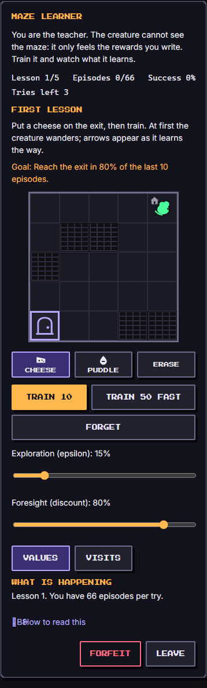
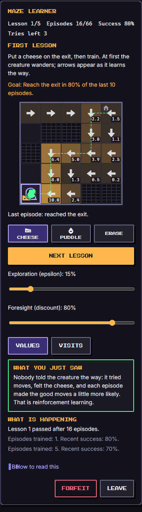
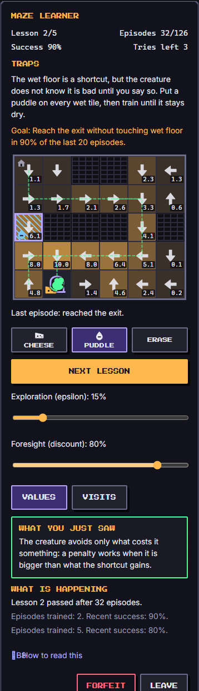

# Maze Learner (`maze-learner`)

An `ai-learning` mini game about **reinforcement learning**: you are the teacher of a small creature that lives in a grid maze. It cannot see the maze and nobody tells it the way. It only feels the **rewards and penalties you write**, tries moves, and slowly learns. You watch arrows (its policy) and a warm heat map (its value estimates) form, change the rewards to teach it something else, and learn what goes wrong when the rewards are badly written. Five short lessons, about four minutes.

Category `ai-learning`, minimum ring 2, roster 1 to 8 (it plays with any party from one vassal up). French name: *Labyrinthe apprenti*. Everything is original: the maze generator, the pictures (drawn in code, SVG) and the text.

## How to play

- **The board.** Grey stone tiles are walls, a house is the creature's home, a door is an exit, a hatched blue tile is wet floor, a star is a bonus tile. The creature starts at home every episode.
- **Write the rewards.** Choose a tool (**Cheese**, **Puddle**, **Erase**) and tap a tile (drag over several with a mouse), or use the keyboard. A cheese is a reward, a puddle (a drop with a minus) is a penalty. Changing a reward restarts the success score, because the rules changed.
- **Train.** **Train 10** shows the creature walking its route episode by episode; **Train 50 fast** runs a chunk of episodes per animation frame; **Stop** interrupts; **Forget** empties what it learned (your rewards stay, the episodes already spent do not come back).
- **Watch it learn.** An arrow on a tile is the move the creature would choose now. **Values** shows the heat map and the number behind it (its estimate of the reward it expects from that tile). The dashed green line is the route of the latest episode.
- **Two dials.** **Exploration (epsilon)**: how often it tries a random move instead of its best one. **Foresight (discount)**: how much it values a reward that is still many steps away.
- **Pass a lesson.** Each lesson has a goal such as "reach the exit in 80% of the last 10 episodes". The learned arrows themselves must also lead to the goal. A lesson has a budget of episodes per **try**; when it runs out the creature forgets and you try again, up to three tries. After the third the game is **lost** ("the troops come home"), which only ends the game with the partial score.
- **Forfeit** ends the game as `fled` and keeps the board on screen; **Leave** is a separate button.

### Keyboard

Arrow keys move the cursor over open tiles (walls are skipped; Shift with an arrow paints with the chosen tool). **C** cheese, **P** puddle, **X** erase, **Space** uses the chosen tool, **Enter** trains 10 (Shift+Enter trains 50 fast), **N** moves to the next lesson once one is passed. Enter and Space on a focused button keep their normal meaning; keys typed in a slider are ignored. The tiles form an ARIA grid with one roving tab stop; every tile has a spoken name ("Row 3, column 2: exit, cheese, value 6.4, it would go up"). Colour is never the only signal: a cheese wedge with holes, a drop with a minus, a house, doors, a star, hatching for wet floor, and the numbers of the heat map.

### Reduced motion

With `reducedMotion` the creature does not walk, hop or animate; training runs in chunks and only the arrows, the numbers and the heat map change. The route line is static.

### The feed

An `aria-live="polite"` log under the controls says what changed ("Cheese placed at row 5, column 5", "Episodes trained: 10. Recent success: 40%") and coaches without nagging, at most one hint per training: remove the breadcrumbs, raise epsilon, put a puddle on every wet tile, look at the rewards you wrote.

## The five lessons

| # | Lesson | What you do | Goal (success window, need) |
| --- | --- | --- | --- |
| 1 | First lesson | put a cheese on the exit, train | reach the exit in 80% of the last 10 episodes |
| 2 | Traps | put a puddle on every wet tile (the short way) so it takes the long dry way | exit without wet floor in 90% of the last 20 |
| 3 | Explore or exploit | two exits you cannot change: a small cheese near, a big one far; set epsilon | far cheese in 70% of the last 15 |
| 4 | Reward shaping | one cheese at the end of a long corridor is almost never found: lay breadcrumbs, then take them away | exit in 80% of the last 15 with no crumbs left |
| 5 | Reward hack | a bonus tile next to home pays every visit and is already rewarded: fix the rewards | exit in 80% of the last 15 |

Every lesson also needs the **learned arrows** to lead from home to the goal (and, in lesson 2, over dry floor only) at the moment it is passed: the lesson is about what it learned, not about luck while exploring. Lesson 5 passes the game: **won**. Each lesson ends with a one-sentence "what you just saw" note (`learned`, in English and French), and the outcome keeps the note of the last lesson passed.

## Learning goals: concepts, facts, how to verify

Every statement the game makes is true of the toy it simulates. The toy is deliberately small: **tabular Q-learning** on a grid of at most 8 by 8, where the creature's whole world is "which tile am I on". Real agents use far bigger states and function approximators, but the ideas below carry over.

| Concept | Fact the game states | How to verify |
| --- | --- | --- |
| Reward, trial and error | The creature is never told the way. It tries moves, feels rewards and each episode makes good moves a little more likely. With no reward on the board there is nothing to learn, and the game says so. | `engine.test.ts`: "opens with nothing to learn from", "the learner reaches the exit within the budget for 100 seeds". In play: the arrows are empty at the start and form after a few episodes. |
| Value estimate | Each move has a value: the reward the creature expects after it, counting later rewards. The heat map shows the best value of each tile. After training along a corridor the value of a tile is the reward times the discount to the power of its distance from it. | "converges to reward x gamma^distance along a corridor" (every tile within 2%). Values are the numbers you can switch on. |
| Policy | The arrows are the policy: in each tile, the move with the best value. | "the arrows only appear where something was learned"; the lesson check follows the arrows from home. |
| Update rule | `Q(s,a) <- Q(s,a) + alpha x (r + gamma x best Q(s',a') - Q(s,a))`, with no look-ahead beyond one step, computed in whole thousandths. | "the update rule" tests: exact hand-computed values, truncation toward zero, no bootstrap on a terminal step. |
| Discount | A discount near 0 makes the creature short-sighted: only the tile next to a reward gets a value. A high one makes it count far rewards. | "a discount of zero values only the tile next to the exit". |
| Penalties | The creature avoids only what costs it something, and only if the penalty is bigger than what the shortcut gains. A penalty in the wrong place teaches nothing about the wet floor. | Lesson 2 tests: without puddles at least 75 of 100 seeds cross the wet floor and almost none pass; with puddles at least 80 of 100 pass and the arrows never touch wet floor. |
| Exploration versus exploitation | With epsilon at zero the creature settles for the first cheese it finds: with the small one near home it stays there. Some exploring finds the big one; exploring all the time never settles. The best recipe is to explore a lot first, then lower epsilon. | Lesson 3 tests: epsilon 0 stays on the near cheese in at least 70 of 100 seeds and passes in at most 20; explore-then-settle passes at least 80 of 100; epsilon at the maximum passes in at most 5. |
| Sparse rewards | When the only reward is far away and the creature wanders randomly, it almost never finds it, so it learns nothing. | Lesson 4 test: without crumbs a 60-episode run finds the exit on average under 1.5 times and the lesson is passed in at most 2 of 60 seeds. |
| Reward shaping | Small guiding rewards (breadcrumbs, eaten once per episode) let it learn the long way; once the habit is built they can be removed and it still works. Crumbs left on the board are not a finished lesson. | Lesson 4 tests: with a trail it learns; the lesson is not passed while crumbs are left; after removing them it passes with arrows that reach the exit. |
| Reward hacking | The creature maximises the reward you wrote, not the goal you meant. A bonus tile that pays every visit is worth `10 / (1 - gamma^2)`, about 27.8 points at the default discount, against about 1.3 for an exit ten steps away, so it circles the bonus forever. Fixing the rewards fixes the behaviour. | Lesson 5 tests: with the bonus rewarded at least 85 of 100 seeds loop on it and none pass; the loop's value is far above the exit's; erasing the bonus reward (or making it a penalty) passes at least 90 of 100. |
| Old habits fade | After you change a reward, values learned under the old rules fade only as the creature acts again. **Forget** wipes them at once. | Lesson 5 "fix" test and "forgetting empties the learner but keeps your rewards". |

### Simplifications, said honestly

- The state is the tile only. Crumbs eaten once per episode are therefore "invisible" to the creature, which is why a dense trail works better than a sparse one.
- There is no cost for a step: preferring the short way comes from the discount alone (a reward sooner is worth more). Episodes have a step cap (30 to 40, 40 in the corridor) so a looping creature does not run forever.
- At difficulty 4 and 5 some steps "slip" into a random direction (5% and 10%), a stand-in for a noisy world.
- The numbers (rewards 10, 2, -10, 4, 30; discount 80%; epsilon 15%) are chosen for a fast, readable toy, not taken from any paper.

## Score (0 to 1000)

| Result | Score |
| --- | --- |
| lesson passed | `120 + up to 60` for each lesson: the 60 scales with the episodes left in the budget of the passing try |
| won (lesson 5 passed) | the above plus `100` |
| lost or fled | the above for the lessons passed, plus the current success rate divided by 5 (0 to 20) |
| each try that ran out | `-10` |

A perfect, instant game would be 1000; a typical won game scores 650 to 900. The outcome `stats` carry `lessons`, `episodes` and `success`; `log` lists every lesson passed; `learned` is the note of the last lesson passed (none if you leave before the first).

## Party

The party is the learning team. Each member matters through `power`, the habit and the count.

- **Power** sets the **learning rate**: `alpha = 320 + 2 x average power` thousandths (clamped 250 to 600). A level 12 party (power 44) learns a little faster per episode than three level 1 vassals (power 8).
- **Members** add **two episodes per member** to the budget of every lesson (8 vassals: +16, 3: +6). The mixed party (a citizen with `habit: null` first) works as any other.
- **Move** (the fast vassal) adds 30 thousandths to alpha and doubles the playback speed of the creature and of the watched training.
- **Study** sees further: the **Values** overlay is on from the start and a second overlay, **Visits**, counts how often the creature stood on each tile. Everyone else can switch Values on at any time; Visits is Study's.
- **Social** adds a **friend** in lesson 3: a second learner that explores a lot (epsilon 60%), trained on the same maze, with its own small arrows (the **Friend** toggle) and a line saying how often it reached the big cheese. It is for comparison and never changes your result.
- **Sleep** makes the creature **dream**: after each episode it replays the same moves once more, so it learns the same lesson in about half as many episodes (measured on lessons 1 and 2).

A level 12 party with all eight habits has every perk; the three starter vassals (Move, Outside, Clean) still win at difficulty 1.

## Buffs

- `time`: **one extra episode per two seconds** on every lesson (20 s gives +10 episodes per try).
- `hint`: the buff's count is the number of tiles the lesson **highlights with a dashed outline**: the exit (lesson 1), the wet tiles (2), the big cheese (3), tiles along the corridor where a crumb helps (4), the bonus tile you should not reward (5).
- `luck`: for the first **three episodes of each try**, each step is chosen with a `luck`% chance to move toward the nearest goal instead of by chance. A luck of 100 gets the creature to the exit at the first episode, so the first success comes early.
- `attack`, `defense`, `revive`: **ignored**. There is no fighting and nothing to revive, and a failed game is never a punishment: the troops simply come home.

## Tuning numbers

Difficulty 1 (gentle) to 5 (hard). The budget is the episodes per try before the buff and party bonuses (`+ 2 per member + time`).

| Number | d1 | d2 | d3 | d4 | d5 |
| --- | --- | --- | --- | --- | --- |
| Lesson 1 budget | 50 | 42 | 36 | 32 | 28 |
| Lesson 2 budget | 110 | 92 | 64 | 50 | 44 |
| Lesson 3 budget | 180 | 150 | 60 | 54 | 50 |
| Lesson 4 budget | 170 | 135 | 100 | 76 | 66 |
| Lesson 5 budget | 70 | 56 | 42 | 32 | 26 |
| Slip (random step) | 0 | 0 | 0 | 5% | 10% |
| Lesson 1 maze | 5x5 | 5x5 | 5x5 | 6x6 | 6x6 |
| Lesson 2 maze, wet tiles | 6x5, 1 | 7x5, 1 | 7x5, 1 | 8x6, 2 | 8x6, 2 |

Rewards (points): exit cheese +10, bonus cheese +10 on every visit, breadcrumb +2 (once per episode), puddle -10 on every entry, near cheese +4, far cheese +30 (the last two are part of lesson 3). Defaults: epsilon 15%, discount 80%. Windows and needs: lesson 1 10 / 80%, 2 20 / 90%, 3 15 / 70%, 4 15 / 80%, 5 15 / 80%. Episode step caps: 30 to 36 (lesson 1), 40 (2, 3, 5 and the corridor).

Mazes are generated from the seed (`maze-learner:<seed>:<lesson>:<difficulty>`), flipped and, for the corridor, turned at random, and are solvable by construction (verified for 120 seeds at every difficulty and lesson in `maze.test.ts`).

### Bot and balance

`botPlay` is a sensible but unadaptive teacher: it writes the rewards the lesson needs (cheese on the exit, a puddle on every wet tile, a trail of crumbs that it removes after 45 episodes, the bonus reward erased), picks an epsilon schedule (explore, then settle; a lot more in lesson 3 until the big cheese is found often) and trains ten episodes at a time. It never forfeits. A game is about 60 to 150 actions. Win rate over seeds 1 to 100:

| Party | d1 | d2 | d3 | d4 | d5 |
| --- | --- | --- | --- | --- | --- |
| full (8 vassals, level 12) | 99% | 97% | 63% | 57% | 17% |
| starter (3 vassals, level 1) | 62% | 30% | 1% | 0% | 0% |
| mixed (a citizen and 4 vassals) | 98% | 95% | 55% | 26% | 1% |
| single (1 vassal, level 5) | 57% | 30% | 0% | 0% | 0% |

A human, who reads the feed and adapts, does better than the bot in lessons 2 to 4. The unit test asserts 40 to 70% for the full party at difficulty 3.

## Determinism

All randomness comes from the seed. The maze: `mulberry32(fnv1a('maze-learner:<seed>:<lesson>:<difficulty>'))`. Each training episode: `turnRng(seed, step)` where `step` counts episodes, so training in chunks of ten or in one go of a hundred gives the same creature. Values, alpha, epsilon and the discount are integers in thousandths (a step never stalls one thousandth short of its target). No `Math.random`, no clock, no `Math.exp` or `Math.pow` with a fraction. The seed, party and run always give the same game, in either language (the language only changes the log).

## Known limits

- It is a toy: a few dozen tiles, one learner, a handful of episodes. Real agents need orders of magnitude more, and the arrows of a real agent are not this tidy.
- The creature sees only its tile, so breadcrumbs (eaten once per episode) need a dense trail; the game uses that as a teaching point rather than hiding it.
- The success score is measured while the creature is still exploring, so you will often lower epsilon at the end of a lesson. This is the lesson, but it can surprise a first-time player; the feed says it.
- The friend in lesson 3 is for comparison only and does not change the outcome.
- Dragging paints a trail of tiles with a mouse or a pen; a finger taps one tile at a time, so that a swipe still scrolls the page. Laying the corridor trail of lesson 4 therefore takes about fifteen taps on a phone.
- Level 1 vassals can win only at difficulty 1 (and sometimes 2) against this bot.

## Screenshots

Written by `e2e/games/maze-learner.spec.ts` (`shootGame`, mobile project).

| A fresh maze | The first lesson learned | Lesson 2, a puddle on the wet floor |
| --- | --- | --- |
|  |  |  |
