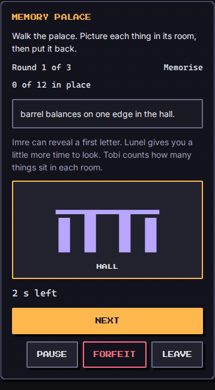

# Memory Palace (`memory-palace`)

A short walk through six original rooms (gate, hall, kitchen, library, garden, tower). In the **memorise** phase each thing appears in a room with a vivid prompt. In the **recall** phase the palace is empty and you put every thing back. The skill is the method of loci: attach each thing to a place, then walk the places to recall them. This is practice, not a test of worth. A missed walk sends the troops home; the rooms wait.

| Field | Value |
| --- | --- |
| Category | self-development |
| Minimum ring | 1 |
| Roster | 1 to 8 |
| Length | about 3 minutes |
| Learning | working and short-term memory (method of loci) |

## How to play

Three rounds. Base counts are 4, then 6, then 8 things. `run.difficulty` (1 to 5) shifts those counts by up to two, shortens the look time, and adds distractors. Difficulty 1 is 2/4/6 things with a long look; difficulty 5 is 6/8/10 with a short look.

During the look, a draining bar shows the time left (plain text when reduced motion is on). **Next** skips the rest of the wait. **Pause** stops the clock. Then tap a room and a thing (or drag a thing onto a room). Keyboard: Tab to a thing, arrows to a room, Enter to place. Every room and every thing has a text label; colour is never the only signal.

Score 0 to 1000: 850 points times the share of correct placements, plus 150 if you used no letter hints. `result` is `won` at 70 percent correct or more, `lost` otherwise, `fled` on **Forfeit**. **Leave** is a separate button.

## Party

The Study troop (`habit: 'study'`) grants one first-letter hint per round (two letters when their `power` is 40 or more). The Sleep troop extends the look time (`floor(power / 4)` extra ticks of 50 ms each). The Social troop shows how many things sit in each room. A starter party of Move, Outside and Clean still plays; they walk without those perks. A level 12 Study/Sleep/Social party is visibly slower to rush and can ask for a letter.

Titles (`traits`) are not used. `troopsUsed` lists the Study, Sleep and Social members who came, or the first member when none of those habits are present.

## Buffs

- `time`: each point (a second) adds one 50 ms tick of look time per thing, capped at 40 ticks, so a 20-second lottery still helps without stretching the contract kit past its step budget.
- `hint`: extra first-letter reveals each round.
- `revive`: one retry of the weakest round after the three walks.
- `luck`: removes one distractor from every round.
- `attack` and `defense` are ignored: there is no incoming hit and no damage to deal.

## Determinism

Setup uses `mulberry32(fnv1a('memory-palace:<seed>'))`. The engine never reads a clock; look time is `{ type: 'tick' }` at `FIXED_DT_MS` (50 ms). The same seed, party, run and locale replay the same rooms and the same outcome. Locale changes the words, the prompts and the log, not the ids.

## Bot

`botPlay` ticks through the look, spends a letter hint when it has one, then places each real thing. On difficulty 1 it never misses. On difficulty 5 it uses a seeded error rate (42 percent) and misses some rooms. On difficulty 2 it wins a comfortable share of walks.

## Technique

The method of loci (the name only): give each thing a place that is hard to mix up, then walk the places. The prompts are original; nothing is copied from a textbook or another work.

## Screenshots

Written by `e2e/games/memory-palace.spec.ts` (`shootGame`, mobile project).

| Start | Recall | End |
| --- | --- | --- |
|  |  |  |

## Known limits

Drag-and-drop is an extra on top of tap and keyboard. The time buff is scaled to the short per-item window (one tick per second, cap 40) rather than adding a full wall-clock second to every card, so the contract kit stays inside 20,000 steps.
