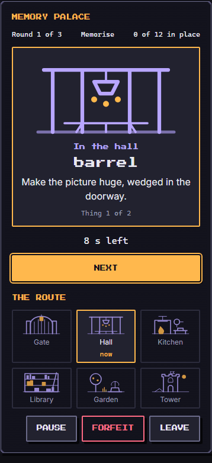
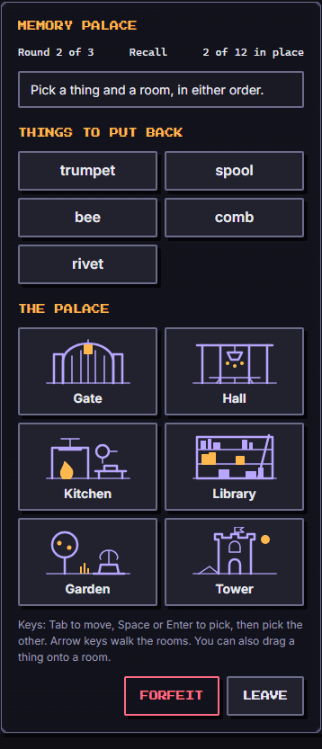
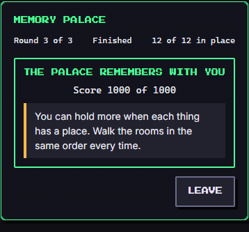

# Memory Palace (`memory-palace`)

A short walk through six original rooms: gate, hall, kitchen, library, garden and tower. In the **memorise** phase each thing appears in its room with a short, vivid caption and a draining look time. In the **recall** phase the palace is empty again and you put every thing back in its room. It practises working and short-term memory through the method of loci. This is practice, not a test of worth: a walk that goes badly sends the troops home, and the rooms wait.

| Field | Value |
| --- | --- |
| Category | self-development |
| Minimum ring | 1 |
| Roster | 1 to 8 |
| Length | about 3 minutes |
| Practises | working and short-term memory (method of loci) |

## How to play

Three rounds, each opening on a ready card ("the palace is empty again"). Press **Begin the walk**, then the things appear one at a time in walking order, from the gate to the tower, so the route itself is the technique. Each look lasts a few seconds (a draining bar, or plain text such as "6 s left" under reduced motion). **Next** moves on before the time is up, **Pause** stops the clock.

Then recall: pick a thing and a room, in either order (touch, mouse or keyboard), and it goes there. A wrong room is told in words and a symbol ("lantern, in the hall: not there", a cross and "(missed)"), and the right room is never revealed. Some words in the list were never in the palace: they are distractors, and placing one counts as a miss.

Keyboard: Tab through the things and rooms, Space or Enter to pick, arrow keys, Home and End to walk the rooms. After a placement the focus goes to the next thing. Dragging a thing onto a room also works with a mouse. Every room and thing has a text label; colour is never the only signal, and the live region announces each step.

**Score** 0 to 1000: 850 points times the share of things in the right room, plus 150 more (scaled the same way) when no letter hint was asked for. **Result**: `won` at 70 percent correct or more across the three rounds, `lost` otherwise (the troops come home), `fled` on **Forfeit** (a partial score, 400 times the share). **Leave** is a separate press that calls `onExit`.

The `learned` note is "You can hold more when each thing has a place", plus one tip of the walk (six tips in each language: make the picture odd, keep the same route, use more than sight, say it aloud, give the thing something to do, rest between rooms).

## The technique

The method of loci (the name only): give each thing a distinctive place and walk the places to bring the things back. The captions are original ("Make the picture huge, wedged in the doorway"). Nothing is copied from a textbook or another work. French nouns carry no article, so the French captions talk about "l'image" and never have to agree with the noun.

## Party

The party changes the walk in ways the player can read on the ready card:

- **Study** (`habit: 'study'`): one first-letter hint per round. A hint names the room and the first letters of a forgotten thing ("In the kitchen, something starts with L"): the place cues the thing, the method in reverse. With `power` of 40 or more it shows two letters. Hints stay on the page for the round.
- **Sleep**: each look lasts longer by half the member's `power`, in 50 ms ticks (power 44 is 1.1 s longer). Flavour: a rested mind holds more.
- **Social**: counts how many things sit in each room and whispers the tip of the round.
- A level 1 starter party plays unaided; a level 12 party with those three habits sees them all. `traits` are not used. `troopsUsed` lists the Study, Sleep and Social members who came, or the first member when none of those habits is present (a mixed party with a citizen is fine).

## Buffs

- `hint`: extra letter hints every round.
- `time`: every look lasts 0.2 s longer per second of buff (4 ticks), capped at 6 s.
- `revive`: when all three rounds have been walked, one retry of the weakest round, a fresh look at the same things.
- `luck`: removes one distractor from every round.
- `attack` and `defense` are ignored: nothing attacks and nothing is attacked.

## Tuning numbers

| Difficulty | 1 | 2 | 3 | 4 | 5 |
| --- | --- | --- | --- | --- | --- |
| Things per round | 2, 4, 6 | 3, 5, 7 | 4, 6, 8 | 5, 7, 9 | 6, 8, 10 |
| Distractors per round | 1 | 2 | 3 | 4 | 5 |
| Look per thing | 8 s | 6.5 s | 5 s | 4 s | 3 s |
| Bot forgets (percent) | 0 | 37 | 44 | 52 | 59 |

The look never drops under 2 s. Words: 150 original concrete nouns per language, no duplicates, none a room name, with confusable groups (lookalikes, near meanings, French collisions) kept out of the same round. Nothing repeats inside one game.

## Determinism and the bot

Setup uses `mulberry32(fnv1a('memory-palace:<seed>'))`. The engine never reads a clock: look time is `{ type: 'tick' }` at `FIXED_DT_MS` (50 ms), `advance` skips ahead. The same seed, party, run and locale replay the same palace and outcome; the locale changes the words, captions and log, not the rooms.

`botPlay` walks (ticks), then places the things in order. It forgets a share of them by difficulty, a little less with a longer look; with a letter hint left it spends it on a thing it forgot (and still misses 35 percent of hinted things); a revive gives it a second, better walk of the weakest round. The error roll is mixed with a hash of the seed, round and word so different palaces forget different things. Over 100 seeds on a plain run with the full party: difficulty 1 wins 100, difficulty 2 wins 68, difficulty 3 wins 53, difficulty 4 wins 15, difficulty 5 wins 6. The starter party (no hints, no rest) wins 100, 31, 18, 2 and 2.

## Screenshots

Written by `e2e/games/memory-palace.spec.ts` (`shootGame`, mobile project).

| Look | Recall | End |
| --- | --- | --- |
|  |  |  |

## Known limits

Drag and drop uses the browser's HTML drag events, so it works with a mouse but not on touch screens (tap two buttons instead). The time buff is scaled to the short per-thing look (0.2 s per second of buff, capped), not added in full to every card. Letter hints reveal the room as well as the letter, a deliberate choice: the words are on the screen in recall, so a bare letter would add nothing. The words exist in English and French only.
