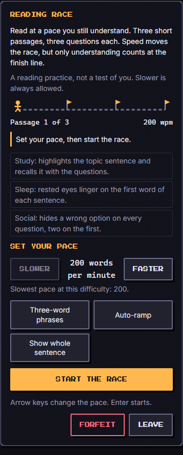
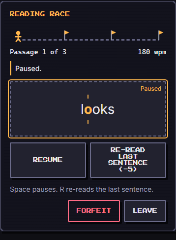
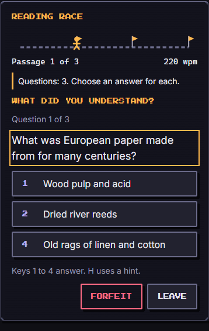

# Reading Race (`reading-race`)

A reading practice dressed as a race. A short passage appears one word at a time, in the same spot, at a pace you choose, and the faster you read the further your runner gets along the course. Then three questions ask what you actually understood. Only understanding counts at the finish line: speed without comprehension is worth very little, and the game says so in its score. It is practice, not a test of the player: slower is always allowed, and a lost race is "the troops come home".

| Field | Value |
| --- | --- |
| Category | self-development |
| Minimum ring | 1 |
| Roster | 1 to 8 |
| Length | about 4 minutes (three passages of 110 to 170 words, then nine questions) |
| Practised | reading speed with comprehension: finding the pace where you still understand |

  

## How to play

1. **Set your pace** (180 to 480 words per minute, in steps of 20) with Slower / Faster or the arrow keys, and choose the modes: **Three-word phrases**, **Auto-ramp**, or **Show whole sentence**. Then **Start the race**.
2. **Read.** One word at a time appears centred, with one letter picked out in amber (the eye's resting point) between two small ticks, so your eyes never need to move. Three-word phrases show three words at once at the same average pace. A **race track** at the top shows your runner moving along three legs, one per passage. **Pause** (or Space) stops the clock. **Re-read last sentence** (or `R`) jumps back to the start of the sentence you are in (or the one before, if you are on its first word) and costs 5 points.
3. **Answer.** Three questions per passage, four answers each, exactly one right: a literal one (the text says it), an inference (the text lets you work it out) and a detail. Tap an answer or press `1` to `4`. The feed says "Right." or "Not this one. The answer was: ...", so each miss teaches something.
4. **Between passages** you may change the pace again (with the Auto-ramp on it moves for you). After the third passage the race ends.

**Show whole sentence** (the accessibility mode) shows each sentence in full and waits for you: tap **Next sentence** (or Space or the right arrow) when you have read it. The pace is then measured from your own taps (clamped to 180 to 480), so it is the reader's real speed. Nothing is animated and nothing moves on its own.

Controls: every control is a real button of at least 44 px. Keys: Space pauses (or shows the next sentence in sentence mode), `R` re-reads, arrow keys change the pace between passages, Enter starts, `1` to `4` answer, `H` uses a hint. After each step the focus moves to the next thing to do (the reading area, the question, the Next passage button, the result), so a whole race can be played with the keyboard. **Forfeit** ends the race as `fled` (it keeps the board and scores what you understood so far); **Leave** is a separate button.

**Reduced motion** (the OS setting or the Lab's switch): nothing in this game eases or animates: the word swaps in place and the runner only moves when a passage is read. The layout and the game are identical. A hidden browser tab pauses the clock.

**Language.** Everything, passages and questions included, comes in English and French; the French passages are written for French readers (they are not translations), and French uses "tu".

## Time and pace (exact)

The engine never reads a clock. One `tick` is 50 ms of game time (`FIXED_DT_MS`). A word costs 1200 units; every tick adds `wpm` units; a word appears when the accumulator has paid for the previous one. So a passage of `W` words takes exactly `ceil(W x 1200 / wpm)` ticks (tested at every pace), and the words per minute really are the words per minute. The Screen turns real time into ticks with `useFixedStep`, so the number of ticks after 4 seconds is the same at 30, 60 and 120 frames per second (tested). A slow frame catches up at most 5 ticks.

## Score and result

Score 0 to 1000 = right answers x a speed factor held under a cap that rises only with comprehension:

- `speed factor = 700 + (average wpm - 180)`: 700 at 180 wpm, 1000 at 480 wpm.
- `cap = 400 + floor(600 x right / 9)`: 400 with nothing right, 1000 with everything right.
- `score = floor(right x min(speed, cap) / 9) - 5 x paid re-reads`, clamped to 0..1000.

Reading faster never lowers the score at the same comprehension, and lower comprehension never raises it at the same pace (both asserted over every combination). The cap is why racing ahead of your understanding scores low: 3 of 9 at 480 wpm is 200, while 8 of 9 at 180 wpm is 622. Everything right at the slowest pace is 700, everything right at the top pace 1000. The average is taken over the pace of each passage.

**Won** at 70 percent comprehension or better (7 of 9). **Lost** below that, with warm words ("The troops come home. The passages will wait for you."). **Fled** on Forfeit. Nothing blames the player.

## What the player learns (`learned`)

The player's best **comprehension-safe pace**: the highest pace at which a whole passage was understood (80 percent or better, which with three questions means all three). The outcome carries it as a number (`stats.safeWpm`, with `stats.safePaceReached` 0 or 1) and as a sentence in English and French, for example "You still understood a whole passage at 300 words per minute. That is a pace worth keeping." When no passage reached 80 percent the note says so kindly and suggests the slowest pace that was tried ("Try about 260 words per minute, and let understanding lead."). The Auto-ramp is built around the same idea: faster after a perfect passage, a step back after a poor one (0 or 1 right), unchanged after a middling one.

This is a practice for noticing your own pace. It makes no claim about reading ability, speed-reading training or anything medical.

## The passages

Twenty passages, **all written for this game** (ten in English, ten written separately in French, not translated), 130 to 170 words each, tagged reading level 1 to 3 by sentence length and vocabulary. Facts are general and checked against common knowledge; no passage copies any book, article or website. Each has three questions with four options and one right answer. The right answer is spread over the four positions (5 to 10 times each per language) and is rarely the longest option, so neither position nor length gives it away (both tested).

| Level | English | Français |
| --- | --- | --- |
| 1 | The extra loaf (a story beat); Why leaves change colour (science); How a zipper works (how it works); Why the Moon changes shape (science) | Le chat de la gare (récit); Pourquoi le ciel est bleu (science); Comment marche un cadenas (mécanisme); Le hérisson de la nuit (nature) |
| 2 | The waggle dance (nature); The penny post (history) | Les six points de Louis Braille (histoire); Le pont du Gard (histoire et technique) |
| 3 | A tide pool after the storm (nature); Paper made from rags (history); The lighthouse lens (history and optics); The last ferry (a story beat) | La tournée de Lina (récit); Inventer le mètre (histoire); Les fourmis jardinières (nature); Le sel des marais (mécanisme) |

The words live in `content/en.json` and `content/fr.json` and are loaded only by the Screen. The engine reads `meta.ts`, a small table generated from them (word counts, sentence starts, the topic sentence, the right answers); `passages.test.ts` fails if the two drift apart.

## Difficulty

`run.difficulty` 1 to 5 changes three things you can see:

| Difficulty | Reading levels drawn | Slowest pace allowed |
| --- | --- | --- |
| 1 | level 1 only | 180 wpm |
| 2 | levels 1 and 2 | 200 wpm |
| 3 | levels 1, 2 and 3 | 220 wpm |
| 4 | levels 2 and 3 | 240 wpm |
| 5 | level 3 only | 260 wpm |

Difficulty 1 is gentle: simple texts at a slow pace, and a first-time player can win by reading at 180 wpm and answering what the text says. The three passages are drawn from the seed, in an order the seed decides.

## Party

The party is the player's real effort made visible. Each of three vassals changes the race in a way shown on the ready screen:

- **Study** (the member whose `habit` is `study`): *highlights the topic sentence.* While the first sentence of a passage is on screen the stage is outlined and labelled "Topic sentence"; the Study troop lingers on it (each of its words costs `120 + 4 x power` extra units, about a quarter more time at power 44), and when the questions come the topic sentence is shown again as a reminder.
- **Sleep**: *rested eyes.* The first word of each sentence stays on screen a little longer (`240 + 6 x power` extra units: about 0.14 s at power 44), which gives the eye time to land on each new sentence.
- **Social**: *hides a wrong option on every question.* From power 30 (around level 9) it hides a second wrong option on the first question of each passage, so a strong Social troop leaves two answers on the first question.
- Other habits and members with no habit take no part in the rules, and every member is listed in `troopsUsed`. The starter party (Move, Outside, Clean at level 1) has none of these perks and the game is fully playable; the bot with the full party wins clearly more often than with the starter party.

## Buffs

Used:

- `hint` (count): that many **hints**. In a question, a "Use a hint" button (or `H`) hides one wrong option. A hint never leaves fewer than two options.
- `time` (seconds): **one passage is re-read for free**: the first re-read in any passage claims it, and every re-read of that passage costs nothing. Any amount above 0 gives one passage.
- `luck`: **an easier passage.** The hardest passage of the draw is swapped for an easier one that was not drawn. At difficulty 1 every passage is already level 1, so luck has nothing to swap.

Ignored, and why: `attack`, `defense` and `revive`. There is nothing to attack or defend in a reading race, and a wrong answer is not a failure that needs reviving (a lost race simply sends the troops home). The contract test declares none of these as ignored because three other buffs and the party do change the game.

## Tuning numbers

| Constant | Value |
| --- | --- |
| Passages per game, questions per passage | 3, 3 |
| Pace range, step | 180 to 480 wpm, 20 |
| Word cost | 1200 units (`60000 / 50`) |
| Paid re-read | 5 points |
| Win | 7 of 9 right (70 percent) |
| Comprehension-safe passage | 3 of 3 right (80 percent or better) |
| Study linger | 120 + 4 x power units per topic-sentence word |
| Sleep linger | 240 + 6 x power units on each sentence's first word |
| Strong Social | power 30 |
| Bot chance to know an answer (percent) | base 74, 54, 50, 46, 44 by difficulty, minus 5 per 20 wpm above the floor, minus 6 per reading level above 1, plus 2 with Study and 1 with Sleep; otherwise a guess among the options still shown |

**Bot results, 100 seeds (50 English, 50 French) per cell, win rate:**

| Difficulty | Full party | Starter party |
| --- | --- | --- |
| 1 | 100 % | 100 % |
| 2 | 60 % | 32 % |
| 3 | 47 % | 8 % |
| 4 | 38 % | 6 % |
| 5 | 34 % | 6 % |

## Known limits

- The words are always timed from the first letter shown: there is no per-word extra time for long words or for punctuation, so a long word costs the same as a short one. It is simple and exact; real reading is not that even.
- A person who reads very fast and understands everything is capped at 480 wpm and at 700 + (pace - 180) per right answer; the top of the range is a practice target, not a measure of reading ability.
- Ten passages per language means seeds repeat passages after a few games; the order and the combination change.
- The comprehension-safe pace is measured on three questions per passage, so it is a rough guide, not a measurement.
- In sentence mode the player can tap through quickly without reading, but then the questions are unanswerable and the score says so.
