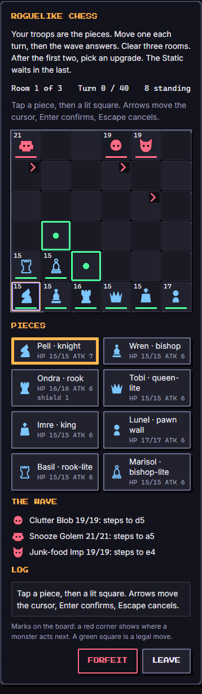
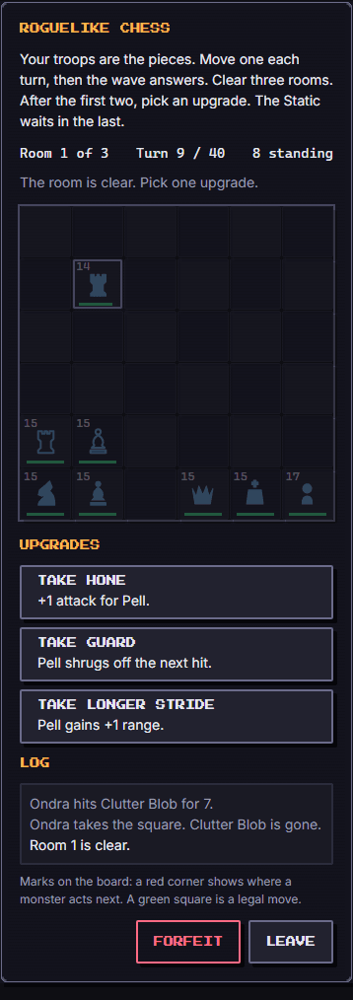

# Roguelike Chess (`roguelike-chess`)

A tiny turn-based tactics game on a 6x6 board. **The troops are the pieces**: each vassal becomes the chess-like piece of its habit, the opposition is the wave monsters, and between three rooms the player picks one of three upgrades. The last room holds the Static. About three minutes, no timer, fully readable: every monster shows what it will do next, so each room is a small puzzle and never a surprise.

Category `strategy`, minimum ring 2, roster 3 to 8 (a party of any size from 3 up plays; a missing habit simply has no piece).

French name: *Échecs vagabonds*. Everything is original: the rules borrow only generic chess movement.

## How to play

- You move **one piece per turn**, then every monster acts. No timer.
- **Tap a piece** (on the board or in the Pieces list): its legal squares light up in green (red ring when the square holds a monster). **Tap a lit square** to move. Moving onto a monster is an attack.
- **Keyboard:** the arrow keys move a cursor over the board (the cursor square holds the focus, so a screen reader reads it); **Enter** selects the piece under the cursor, then confirms the move; **Escape** cancels the selection. Enter on the Forfeit and Leave buttons keeps its normal meaning.
- **The wave is shown, not hidden.** A red mark in the corner of a square (a chevron for a step, a cross for a strike, a drop for a drain, a plus for a split) is where a monster will act next. A dashed red outline on one of your pieces means it is about to be hit. The Wave list under the board says the same in words. After your move the monsters follow exactly what was shown (they do not re-plan), then new intentions are shown for the next turn.
- **Combat.** Damage of a capture = the piece's attack (plus the Rally passive and the Piercing upgrade). If the monster's HP reaches 0 the piece takes its square; otherwise the piece stays where it was (the blow "bounces"). A monster hitting a piece works the same way: if the piece falls the monster takes its square, otherwise it stays put.
- **Three rooms.** Room 1: two or three weak monsters. Room 2: three or four mixed ones. Room 3: the Static with one to three minions. After rooms 1 and 2 you pick **one of three upgrades** (12 exist).
- **Win:** clear room 3. **Loss:** every piece is down, or 40 turns pass in a room (the turn cap). A loss is "the troops come home", never a punishment. **Forfeit** ends the game as `fled` and keeps the board on screen; **Leave** is a separate button that calls `exit()`.
- A piece with no legal square is skipped; if nothing can move, the turn passes (`wait`).

Controls are all real buttons of at least 44 px; the board is a labelled grid; the log is an `aria-live` region (the last three lines stay visible, the newest in normal text).

### Score (0 to 1000)

| Result | Score |
| --- | --- |
| won | `700 + 30 per piece standing + 2 per remaining HP - 3 per turn used`, clamped |
| lost | `180 per room cleared + 2 per turn survived in the last room` |
| fled | `120 per room cleared + 25 per piece standing` |

## The pieces

Each troop is a piece, chosen by habit. The pieces are drawn in code (SVG): filled silhouettes are full pieces, outlined ones are the "lite" versions.

| Habit | Piece | Moves | Notes |
| --- | --- | --- | --- |
| Move | knight | L-shaped jump (2+1), over anything | never onto an ally |
| Outside | bishop | diagonal slide, any distance | stops at the first obstacle; may capture it |
| Clean | rook | orthogonal slide, any distance | same |
| Social | queen-lite | any of 8 directions, up to 3 squares | |
| Study | king | one step in any of 8 directions | also gives **hints** (lights the best capture) |
| Sleep | pawn wall | one step forward or sideways | never backward; "blocks" the line |
| Eat | rook-lite | orthogonal slide, up to 2 squares | |
| Hygiene | bishop-lite | diagonal slide, up to 2 squares | |
| none (a citizen) | pawn wall | as Sleep | future citizens |

"Forward" is toward the monsters (up the board). Every piece can capture on any square it can reach. Sliders are blocked by allies and stop on monsters.

### Stats

- **HP** = `3 + level + floor(defense buff / 10)`, plus passives.
- **Attack** = `1 + floor((level + 2) / 3)` + `floor(attack buff / 10)` + 1 when `loyalty > 70`, plus passives. A level 1 vassal has 4 HP and 2 attack; a level 12 vassal with loyalty 80 has 15 HP and 6 attack.
- **Passives** (each earned title gives one; unknown titles give the generic *tidy*):

| Title id | Passive | Effect |
| --- | --- | --- |
| `first_vassal` | vanguard | +1 attack |
| `pathfinder` | skirmisher | the knight can also take a king step |
| `dawn_walker` | longstep | +1 range on lite sliders (queen-lite, rook-lite, bishop-lite) |
| `steward_apprentice` | tidy | +1 HP |
| `scrubbed_spotless` | barrier | starts with a 1-point shield |
| `herald` | rally | +1 damage for every piece while this one stands |
| `stairwell_scholar` | insight | its captures are hinted, like Study |
| `night_warden` | sentinel | +2 HP |

## The monsters

Each has a tiny scripted behaviour. Ties are broken deterministically (nearest piece by Manhattan distance, then by id). The "weak" ones have the least HP; the intention is locked at the start of your turn.

| Monster | Class | Behaviour |
| --- | --- | --- |
| Clutter Blob | weak | advances one orthogonal step toward the nearest piece |
| Procrastination Moth | mixed | jumps like a knight toward the nearest piece |
| Doomscroll Wyrm | mixed | slides orthogonally up to 2 squares toward the nearest piece |
| Dust Bunny | weak | **splits** once: leaves one 1-HP copy on an empty neighbour (the copy cannot split), then advances |
| Snooze Golem | tough | advances on even turns and waits on odd ones |
| Couch Leech | mixed | **drains** an adjacent piece (attack damage), otherwise advances |
| Fog Wraith | mixed | slides diagonally up to 2 squares |
| Junk-food Imp | weak | jumps two orthogonal squares toward the nearest piece |
| Silence Specter | mixed | drains a piece within 2 squares, otherwise advances |
| the Static | boss | room 3 only; drains when adjacent, otherwise advances; the highest HP and attack |

Rooms pick their monsters from a shuffled pool with the seed: room 1 from Blob, Bunny, Imp, Golem; room 2 from Moth, Wyrm, Leech, Wraith, Specter, Blob, Bunny, Imp; room 3 is the Static plus minions from Specter, Wyrm, Leech, Golem, Moth. Monsters start on ranks 4 to 6, your pieces on ranks 1 and 2.

## Upgrades

After rooms 1 and 2 three different upgrades are offered, drawn with the seed (`luck` weights the stronger ones). The offer names its target piece (the strongest, or the weakest, depending on the upgrade).

| Upgrade | Effect |
| --- | --- |
| Hone | +1 attack for the named piece |
| Field kit | every living piece is healed to full |
| Second step | the named piece may move twice, once per room |
| Switch places | two pieces swap squares |
| Shield the weak | the named piece gains a 2-point shield |
| Come home | a fallen piece returns (1 HP), or, if nobody has fallen, the next piece to fall returns once |
| Longer stride | +1 range for the named piece (a knight gains king steps) |
| Brace | every living piece gains +1 max HP and heals 1 |
| Borrowed time | +8 turns before the room cap |
| Piercing | +1 damage on every capture, for the rest of the run |
| Guard | the named piece gains a 1-point shield |
| Back line | the named piece steps to a free square on the first rank |

## Party

Every member of the fitted party is a piece. **Level** sets HP and attack; **loyalty** above 70 adds +1 attack; **habit** chooses the piece (a party without `move` has no knight, a citizen with `habit: null` is a pawn wall); **traits** give named passives; **Study**, or the `stairwell_scholar` title, lights the best capture. A level 12 party (HP 15, attack 5 to 7) hits and survives far more than three level 1 vassals (HP 4, attack 2), and has more pieces to choose a move from. To keep a first game fair, monsters toughen a little with the party's average level (`floor(average level x 2 / 3)` extra HP, and +1 attack per 4 of that), so a level 12 party is stronger but cannot walk through, and a level 1 party still has a gentle first room.

## Buffs

- `attack`: +1 damage per 10 points, on every piece.
- `defense`: +1 max HP per 10 points, on every piece.
- `time`: +1 turn on the room cap per 5 seconds (20 s gives a cap of 44).
- `hint`: the best capture is highlighted on the board.
- `revive`: the first piece to fall returns once (1 HP, on the first free square of the lowest rank).
- `luck`: weights the upgrade offers toward Field kit, Come home, Piercing and Second step first, then Hone, Shield the weak, Longer stride and Brace.

## Tuning numbers

Difficulty 1 to 5, `tough = floor(average level x 2 / 3)` over the fitted party.

| Number | d1 | d2 | d3 | d4 | d5 |
| --- | --- | --- | --- | --- | --- |
| Room 1 monsters | 2 | 2 | 3 | 3 | 3 |
| Room 2 monsters | 3 | 3 | 4 | 4 | 4 |
| Room 3 minions | 1 | 1 | 2 | 2 | 3 |
| HP step added to every monster | 0 | 1 | 9 | 10 | 10 |
| Base attack | 1 | 1 | 2 | 3 | 3 |
| Static attack | 2 | 2 | 5 | 5 | 5 |

Monster HP = base + step + tough, with base 2 (Blob, Bunny, Imp), 3 (Moth, Wyrm, Leech, Wraith, Specter), 4 (Golem); the Static has `6 + 3 x (d - 1) + tough`. Monster attack = base attack (the Golem, Leech and Specter get +1 from d4) + `floor(tough / 4)`.

Turn cap 40 per room (`+floor(time / 5)`, `+8` with Borrowed time).

### Bot and balance

`botPlay` is greedy: it captures whenever it can (killing blows first, the Static most of all), otherwise steps toward the nearest monster and steps off lethal intentions; on the upgrade screen it takes the best-scoring card, breaking near ties with its own PRNG. It never forfeits and always terminates (a game is at most about 100 actions). Win rate of that bot (seeds 1 to 100, no buffs):

| Party | d1 | d2 | d3 | d4 | d5 |
| --- | --- | --- | --- | --- | --- |
| full (8 vassals, level 12) | 100% | 100% | 62% | 49% | 16% |
| starter (3 vassals, level 1) | 87% | 34% | 0% | 0% | 0% |
| mixed (a citizen and 4 vassals) | 86% | 75% | 6% | 6% | 1% |

Over 200 seeds the full party wins 60% at difficulty 3 (the unit test asserts 40 to 70%). A human beats the bot: it uses the shown intentions and the upgrades better.

## Determinism

Everything comes from the seed: `mulberry32(fnv1a('roguelike-chess:<seed>:room:<n>'))` for a room's monsters and positions, `...:up:<rooms cleared>` for the upgrade offers. Monster moves are a pure function of the state with fixed tie-breaks, so the same seed, party and run always give the same game, in either language (the locale only changes the log text). No clock, no `Math.random`, integer maths only.

## Known limits

- Monsters never re-plan after your move: a monster may walk into a square you just freed, or waste its move on a square you now occupy (it strikes if a piece is there). This is deliberate: it keeps the room a puzzle.
- A piece can only attack by moving; there is no ranged attack from the player's side.
- Only the pawn wall is limited to forward and sideways steps; there is no promotion.
- The optional "show how the enemy thinks" panel was cut (see the notes file): the intention marks and the Wave list already show the rule.
- The bot does not use Second step well, and a level 1 party is not meant to win above difficulty 2.

## Screenshots

Written by `e2e/games/roguelike-chess.spec.ts` (`shootGame`, mobile project).

| A piece selected | An upgrade between rooms |
| --- | --- |
|  |  |
