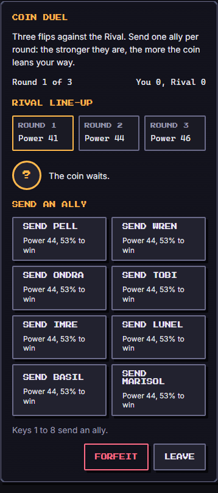
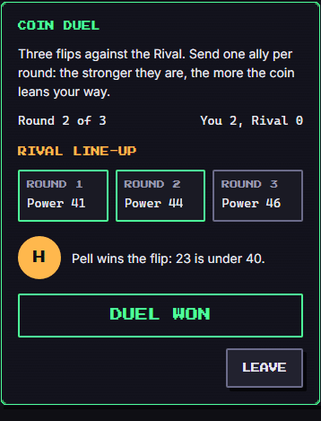

# Coin Duel (`sample`)

The reference game of the plug-in contract (`docs/design/games/CONTRACT.md`). Dev-only: listed in the Games Lab (`#/lab/sample`), never in the Arena. Every new game copies its folder, `src/games/sample/`.

| Field | Value |
| --- | --- |
| Category | strategy |
| Minimum ring | 1 |
| Roster | 1 to 8 |
| Length | about 1 minute |
| Learning | reading odds (probability, expected value) |

## How to play

The Rival fields three duelists of known power, one per round. Each round you send one ally and a coin is flipped. The coin is weighted by the gap in power: `chance = 50 + ally power - rival power + edge`, clamped to 10..90 percent. An ally sent again is tired: -10 power for each round they already played. First to two flips wins the duel. **Forfeit** ends the duel as `fled`.

Touch: tap an ally. Keyboard: Tab to an ally and press Enter, or press `1` to `9` to send the n-th ally. **Forfeit** (the engine's `forfeit` action) ends the duel as `fled` and keeps the board on screen; **Leave** is a separate button that calls `exit()`.

Reduced motion: the coin does not spin; everything else is the same.

Score: 1000 for a 2-0 win, 750 for 2-1; a lost duel scores 200 per round won; a forfeit 100 per round won.

## Party

Every member of the party is an ally you can send; their `power` (level plus loyalty) is the main term of the odds. A level 12 party (power 44) beats the first rival about half the time; a level 1 party (power 8) rarely does. Titles (`traits`) are not used. Fatigue makes a big party matter: with three or more allies you never need to send a tired one.

## Buffs

- `attack` and `luck`: each point is +1 percentage point on every flip (the "edge").
- `revive`: each one re-flips one lost round.
- `time`, `defense` and `hint` are ignored: the duel has no timer, no incoming damage and nothing hidden.

## Determinism

The rival line-up comes from `mulberry32(fnv1a('sample:<seed>'))` (salted with the game id); each flip from `turnRng(seed, round)`. The same seed, party and run always give the same duel. The locale changes only the language of the log.

## Bot

`botPlay` sends the ally with the best odds and breaks near-ties (within 2 points) with its own `rng`.

## Screenshots

Written by `e2e/games/sample.spec.ts` (`shootGame`, mobile project).

| Start | End |
| --- | --- |
|  |  |
