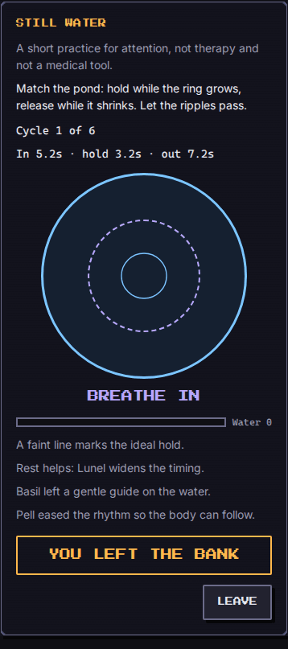

# Still Water (`still-water`)

A still pond. A soft ring expands and contracts with a slow breath. Hold with the inhale and the peak, release with the exhale. Small ripples (a leaf, a fish, a flicker) pass after the first two cycles: let them go. The water level is a running score, never a failure state.

This is a short practice for sustained attention and calm pacing. **It is not therapy and not a medical tool.**

| Field | Value |
| --- | --- |
| Category | self-development |
| Minimum ring | 1 |
| Roster | 1 to 8 |
| Length | about 2 minutes |

## How to play

Touch: press and hold the large **Hold with the breath** button while the ring grows (and while it rests at the peak); release while it shrinks. Keyboard: Space or Enter do the same. Every control is a real button.

An optional **Tap each phase** mode (off by default) lets you press once at the start of breathe in, hold, and breathe out instead of holding. An optional **Pulse on phase change** uses `navigator.vibrate` when the browser supports it; it is off by default. There is no sound.

**Pause** stops the clock. **Step away** is the engine's forfeit and ends as `fled` while keeping the board. **Leave** is a separate button.

Reduced motion: the ring is replaced by a progress bar. The same text cue (`Breathe in` / `Hold` / `Breathe out`) stays in an `aria-live` region, so a screen reader can follow the game.

A game lasts 5 to 8 cycles, always under two minutes.

## Rhythm table

One tick is 50 ms (`FIXED_DT_MS`). Difficulty 1 is the brief's 4-2-6. Difficulty 2 is 5-3-7. Difficulties 3 to 5 are faster, shorter cycles.

| Difficulty | Inhale | Hold | Exhale | Cycles | Base grace | About |
| --- | --- | --- | --- | --- | --- | --- |
| 1 | 4 s | 2 s | 6 s | 5 | 8 ticks (400 ms) | gentle |
| 2 | 5 s | 3 s | 7 s | 6 | 6 ticks | longer hold |
| 3 | 4 s | 2 s | 5 s | 6 | 5 ticks | a little faster |
| 4 | 3 s | 2 s | 4 s | 7 | 3 ticks | fast |
| 5 | 3 s | 1 s | 3.5 s | 8 | 2 ticks | fastest |

The Move troop adds `floor(power / 10)` ticks to every phase. Sleep and the `time` buff widen the grace window around each boundary (capped so a core of each phase remains).

## Score

Accuracy is the overlap between the player's hold and the ideal hold (inhale + peak). Grace ticks at the boundaries are ignored. A cycle that lands under 50 percent can be forgiven once by a `revive` (counted as 70 percent).

Final score, clamped to 0..1000:

`averageAccuracy * 10 + steadiness * 8 + (hint ? 10 : 0) - (100 - calm)`

Calm starts at 100; tapping a ripple costs 15. Each ignored ripple adds 1 to steadiness. **Won** at 600 or more. **Lost** otherwise, with warm copy: "The pond is still here. Try again whenever you like." **Fled** on Step away. Never shame.

`learned` is a one-line note about slow exhales, phrased as a general practice tip, not advice.

## Party

- **Sleep**: rest helps. `floor(power / 8)` extra grace ticks. A level-12 Sleep vassal (power 44) is clearly more forgiving than a party with no Sleep.
- **Eat**: leaves a faint ideal-timing guide on the water (`showHint`) and the +10 hint bonus.
- **Move**: eases the rhythm. `floor(power / 10)` extra ticks on every phase, so a practised mover gives the body more time.
- Every member sits by the pond and is listed in `troopsUsed`. Titles are not used. Playable with three level-1 vassals and with a citizen (`habit: null`).

## Buffs

- `time`: +1 grace tick per second of buff.
- `hint`: the same guide as Eat, and the +10 bonus.
- `revive`: forgives one missed cycle.
- `luck`: removes one planned ripple.
- `attack` and `defense` are ignored: there is no combat.

## Determinism

Setup (gusts that the bot sits out, and the ripples) comes from `mulberry32(fnv1a('still-water:<seed>'))`. Time is only `{ type: 'tick' }`. The same seed, party and run always give the same game. The locale changes only the language of the log.

## Bot

`botPlay` holds late by a difficulty-dependent number of ticks and skips gust cycles. It never taps a ripple and never forfeits. On difficulty 1 it usually wins; on 5 it wins less often.

## Screenshots

Written by `e2e/games/still-water.spec.ts` (`shootGame`, mobile project).

| Start | Reduced motion | End |
| --- | --- | --- |
|  |  |  |
