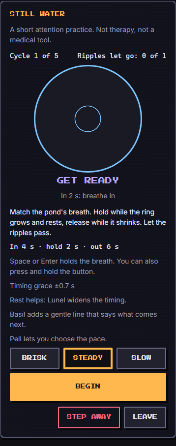
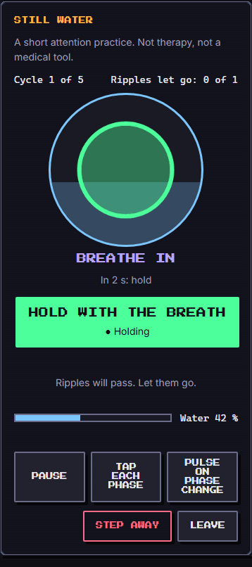
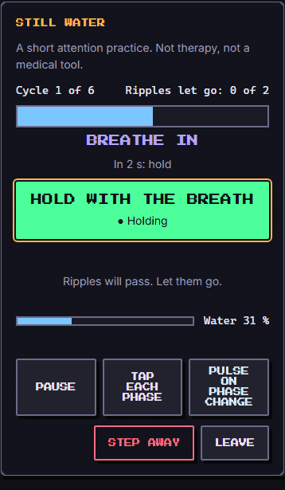

# Still Water (`still-water`)

A still pond. A soft ring grows while you breathe in, rests at the top, and shrinks while you breathe out. You hold a button (or Space, or Enter) with the breath and let go as it falls, as closely in time as you can. Small ripples (a leaf, a fish, a flicker of light) drift past after the first two cycles: let them go, do not touch them. The pond fills as your breathing matches. It is a short, forgiving attention exercise for the Arena, never a test you can fail in a way that matters.

**This is a practice for sustained attention and calm pacing. It is not therapy and not a medical tool.** It makes no health claim, gives no diagnosis and is no substitute for professional care. The same one-line note ("A short attention practice. Not therapy, not a medical tool.") is on screen all the time, in English and French.

| Field | Value |
| --- | --- |
| Category | self-development |
| Minimum ring | 1 |
| Roster | 1 to 8 |
| Length | about 1 to 1.5 minutes (62 to 92 s) |
| Practised | sustained attention, slow pacing |

## How to play

1. **Ready.** The first screen shows the rhythm, what your party brings and a **Begin** button. A troop of Move lets you pick the pace here (below).
2. **Get ready.** Two seconds of lead-in (cue "Get ready"). Nothing is scored.
3. **Breathe.** Hold with the breath in and with the rest at the top ("Hold"), let go during the breath out. Each cycle is scored on its own and a short line under the pond reports it ("Cycle 2: the breath matched 84 %.").
4. **Ripples.** A leaf, a fish or a flicker shows in a reserved row, for 1.5 to 2.5 seconds. Ignore it: that adds to your **steadiness** (shown as "Ripples let go: 1 of 2"). Touch it and you lose a little **calm**. Only one ripple is on the water at a time and none appears in the first two cycles.
5. **The end.** After the last cycle the pond shows its words and the score. You can **Step away** at any time (the game's own leave action: it ends as `fled`, keeps the pond on screen and scores the cycles you did), and **Leave** is a separate button.

Controls (every one is a real button of at least 44 px):

- **Hold with the breath**: press and hold the big button with a finger or the mouse, or press and hold **Space** or **Enter** (the button has the focus once you begin). A key held when the window loses focus lets go by itself.
- **Pause** stops the clock and releases the breath. A hidden browser tab pauses the game and shows "Paused" when you come back.
- **Tap each phase** (off by default): for people who cannot hold. Press once when the breath in starts and once when the breath out starts; a press during the breath in or the rest means "hold", a press during the breath out means "let go", and a press in the last half second before a change already counts for the new phase (so a slightly early tap is not lost). A press never toggles, so one missed tap cannot turn the later ones around. It is the same score, only the way of telling it differs. Turning the mode off lets go of the breath.
- **Pulse on phase change** (off by default, shown only where the browser has `navigator.vibrate`): a 12 ms vibration at each phase change. There is **no sound** and no setting for one. Both options reset at every game; nothing is stored.

**Reduced motion** (the OS setting, or the Lab's switch): the ring is replaced by a plain progress bar and the same text cue ("Breathe in", "Hold", "Breathe out") in a polite `aria-live` region, so a screen reader announces every phase (with a hint, also how many seconds the phase lasts). Holding is shown by a word and a shape on the button ("● Holding" or "○ Let go") as well as by its colour. When the game ends the cue says "Done" and the focus moves to the result. The bar has the role `progressbar`, a name and a text value that changes only at a phase change (no number is read twenty times a second). The ring itself is hidden from assistive technology, since the cue says everything. Nothing flashes or changes brightness suddenly; the game plays the same.

## Rhythm table

One tick is 50 ms (`FIXED_DT_MS`), the engine counts ticks and never reads a clock. Times are inhale, hold (the rest at the top) and exhale. The cycle count is fixed per difficulty; the lead-in adds 2 s.

| Difficulty | Inhale | Hold | Exhale | Cycle | Cycles | Game length | Base grace |
| --- | --- | --- | --- | --- | --- | --- | --- |
| 1 | 4 s | 2 s | 6 s | 12 s | 5 | 62 s | 8 ticks (0.4 s) |
| 2 | 5 s | 3 s | 7 s | 15 s | 6 | 92 s | 6 ticks (0.3 s) |
| 3 | 4 s | 2 s | 5 s | 11 s | 6 | 68 s | 5 ticks (0.25 s) |
| 4 | 3 s | 2 s | 4 s | 9 s | 7 | 65 s | 3 ticks (0.15 s) |
| 5 | 3 s | 1 s | 3.5 s | 7.5 s | 8 | 62 s | 2 ticks (0.1 s) |

Difficulty 1 is the brief's 4-2-6; difficulty 2 is 5-3-7, the longest and slowest; 3 to 5 are shorter cycles with a narrower grace. The Arena's difficulty maps straight on (`run.difficulty`).

**Pace (Move troop).** A party with at least one `move` vassal can choose, before it begins, a **Brisk** (80 % of every phase), **Steady** (100 %, the table above) or **Slow** (125 %) pace. There is no score multiplier: the grace and the scoring are the same, only the length of the breath changes (a slow game at difficulty 2 lasts 114 s, still under two minutes). The choice is the engine's `pace` action, accepted only before the first tick.

## Score

Each tick of a cycle is one of three kinds. The first and last `grace` ticks of a cycle and `grace` ticks on each side of the release point are **grace**: not scored, so a late press, an early press or a late release inside the grace costs nothing. A **hold tick** is where the ideal is held; a **release tick** is where it is not.

`cycle accuracy = floor(100 × max(0, hits / H − false holds / R))`, where `H` is the number of hold ticks in a cycle (`inhale + hold − 2 × grace`) and `R` the number of release ticks (`exhale − 2 × grace`), `hits` the hold ticks in which you were holding and `false holds` the release ticks in which you were holding. Each side is its own share, so the grace can widen without ever making "hold all the time" pay: holding every tick is 100 − 100 = 0, and never holding is 0, at every difficulty, pace, party and buff (`engine.test.ts` sweeps all of them, including the largest Sleep and `time` grace).

- Perfect: 100. Never held: 0. Always held: 0.
- Press `L` ticks late, past the grace: you lose `L / H` of the hold. Release `L` ticks late: `L / R` is counted as a false hold. Release `E` ticks early: you lose `E / H`.
- Skipping only the rest at the top (holding during the breath in, letting go when the ring stops growing) loses only the rest's share of `H` (a quarter to 40 percent); difficulty 5 is the most lenient there (its rest is 1 s of 4 s, a quarter), difficulty 4 the strictest (2 s of 5 s, 40 percent), so a player can still win that way; the rest phase counts for what it is, not more.
- A cycle under 50 percent is forgiven by a `revive` buff and counts as 70 (at most a third of the cycles, so a buff cannot turn no play into a win).

`score = round(mean cycle accuracy × ceiling / 100)`, where cycles you did not play count as 0 and `ceiling = 850 + floor(100 × ripples let go / ripples) + floor(50 × calm / 100)` (with no ripples the whole 100 is kept). `calm` starts at 100 and every ripple touched costs 15. The ceiling is why ignoring the ripples matters: perfect breathing and no touch scores 1000, perfect breathing and every ripple touched is at most 892.

**Won** at 600 or more (60 percent), with "Still water. Well breathed." (French: "Eau calme. Belle respiration."). **Lost** below that, with warm words: "The pond is still here. Try again whenever you like." (French: "L'étang est toujours là. Reviens quand tu veux."). **Fled** when you step away. Nothing in the copy blames the player: the troops simply come home.

The **water** of the pond is a smooth running score: the same hits-over-hold minus false-holds-over-release measure over all the ticks so far, never below 0, filling over the first cycle. It is a picture of how the breath matches, never a failure state. The final `Outcome.stats` carry the cycle count, mean accuracy, water, steadiness, ripples, taps, calm, revives used, grace in ticks, hint cycles and pace.

`learned`: topic "Slow exhales" (French "Expirations lentes") and a one-line general practice tip: "A common practice tip: letting the out-breath run a little longer than the in-breath can help you feel steadier. A general tip, not advice." (French in the same spirit, with "tu".)

## Party

The party is how much rest, food and movement the player really put in, and each of the three habits changes the pond in a way you can see before you begin:

- **Sleep** ("Rest helps"): the timing grace widens by one tick per 8 power of Sleep troops (`floor(power / 8)`). Level 12 and loyalty 80 (power 44) gives 5 more ticks (0.25 s) on each side of every boundary; the ready screen says the grace in seconds.
- **Eat**: a gentle line under the cue says what comes next and when ("In 3 s: hold"), for the whole game. It is visual only (it does not repeat in the screen reader, which gets the phase change).
- **Move**: the pace choice above, and the troop is named on the ready screen.
- Every member sits by the pond and is listed in `troopsUsed`. Members with no habit (citizens) and the other habits (Outside, Clean, Social, Study, Hygiene) take no part in the rules, but the game is playable with any party, even one troop. Titles (`traits`) are not used. With the three starter vassals (Move, Outside, Clean, level 1) the game is fully playable and a fresh player simply has the base grace.

## Buffs

- `time` (seconds): one extra grace tick per 2 seconds of buff (20 s is 10 ticks, half a second). The grace is capped at the shortest phase minus 2 ticks, so a scored core always remains.
- `hint` (count): the "what comes next" line for that many cycles (all of them with an Eat troop).
- `revive` (count): that many cycles under 50 percent count as 70 percent, at most a third of the cycles (1 at difficulty 1, 2 from difficulty 2).
- `luck`: removes one ripple from the pond for any amount (the planned count is 1, 1, 2, 2, 3 by difficulty).
- `attack` and `defense` are ignored: there is no combat and no damage in a breathing exercise.

## Determinism

Setup comes from `mulberry32(fnv1a('still-water:<seed>'))`: only the ripples (kind and time, one slot each after the first two cycles). The pace rebuilds that layout from the same seed. Time is only `{ type: 'tick' }`; the score is integer arithmetic over ticks, so a seed replays identically on any device. The locale changes only the language of the log. The engine files use no clock, no `Math.random` and no `navigator`; the vibration and the focus handling live in `Screen.tsx`.

## Bot

`botPlay` presses `p` ticks after each cycle starts and lets go within `r` ticks of the ideal point, where `p` and `r` are drawn per cycle from the seed (`turnRng(seed, 1000 + cycle)`) and scaled by the difficulty; with a seeded chance the cycle is a lapse of attention and the errors triple. It also taps, with a seeded chance, a ripple a few ticks after it appears. It never steps away. The table is tuned so that the bot's win rate falls with the difficulty (400 seeds each, full party and starter party):

| Difficulty | Bot error (spread / lapse % / ripple tap %) | Starter party wins | Full party wins |
| --- | --- | --- | --- |
| 1 | 40 ticks / 20 / 0 | 91 % | 94 % |
| 2 | 52 / 40 / 10 | 55 % | 63 % |
| 3 | 42 / 40 / 15 | 46 % | 57 % |
| 4 | 36 / 40 / 20 | 35 % | 53 % |
| 5 | 32 / 40 / 25 | 22 % | 42 % |

The step from difficulty 1 to 2 is partly the bot's own spread (40 ticks at difficulty 1, 52 at difficulty 2, a looser breather; the table is a tuning of win rates, not of how a person breathes), not only the rhythm. The bot is a clumsy breather on purpose (its press is up to 2 seconds late at difficulty 1) so that normal difficulty sits in the 40 to 70 percent band; a person following the ring is much more precise than that.

## Known limits

- Real-time play from the keyboard or a touch needs the tab to be visible; a hidden tab pauses the game.
- A screen reader user hears the phases and one report per cycle, not a running water level. The pond's water is a visual bonus.
- Tap each phase accepts a press up to 10 ticks (half a second) before a change as belonging to the new phase; earlier than that it still counts for the current one.

## Screenshots

Written by `e2e/games/still-water.spec.ts` (`shootGame`, mobile project).

| Start | Playing | Reduced motion |
| --- | --- | --- |
|  |  |  |
