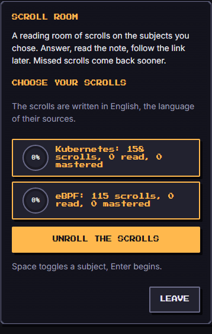
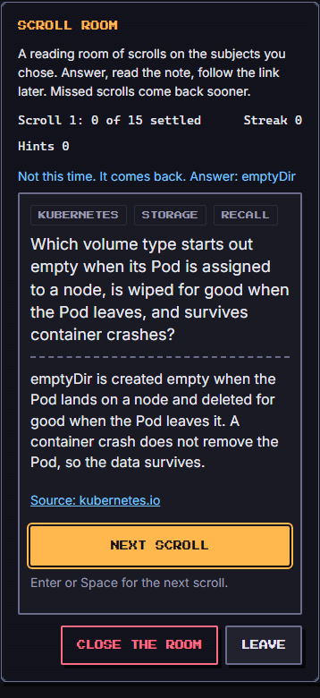
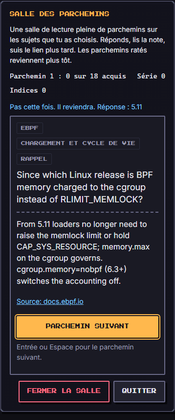

# Scroll Room (`subject-scrolls`)

A reading room full of scrolls on the subjects you chose. Each scroll is a card from a subject deck: a question with four answers, a short answer to type, or steps to put in order. After every answer the scroll unrolls its explanation and a link to the page it was written from. Missed scrolls come back sooner, as in Word Forge, whose spaced-repetition scheduler this game shares. It is practice, not a test: a run that goes badly is "the troops come home", and the scrolls will wait.

| Field | Value |
| --- | --- |
| Category | self-development |
| Minimum ring | 1 |
| Roster | 1 to 8 |
| Length | about 3 minutes |
| Learning | chosen subjects (Kubernetes and eBPF decks), spaced repetition |

## How to play

The room opens on a **lobby**: pick one or both decks (each shows how many scrolls you have read and settled) and unroll them. The selection and your per-card progress are kept on this device (see Known limits).

A run draws **15 to 20 cards** (15 at difficulty 1, 16, 17, 18, then 20 at difficulty 5) from the selected decks, weighted toward recall cards at low difficulty and puzzles at high difficulty, and toward cards you missed before. Each card is shown, then scheduled again:

- a wrong answer returns after **2** further cards, then after **5** if it is missed again;
- a first right (or "almost") answer returns once more after **8** cards (after **6** with a Study troop) for a final check;
- a card is finished after that final check, or after four shows (the game is always bounded).

| `run.difficulty` | Input | Cards | Draw |
| --- | --- | --- | --- |
| 1 | four options | 15 | mostly recall |
| 2 | four options | 16 | recall and apply |
| 3 | typed when the answer is at most 24 characters, ordered when the card has steps, else four options | 17 | apply, some puzzles |
| 4 | typed up to 32 characters, ordered, else options | 18 | apply and puzzles |
| 5 | typed up to 48 characters, ordered, else options | 20 | mostly puzzles |

**Controls.** Touch: tap an option, tap the steps in order then **Answer**, or type and press **Answer**. Keyboard: `1` to `4` pick an option; on ordered cards `1` to `5` add the step shown with that number, Backspace removes the last one, Enter answers; on typed cards the field is focused for you. After an answer the **Next scroll** button takes focus, so Enter moves on. **Close the room** ends the game as `fled` with the score so far and keeps the board on screen; **Leave** is a separate button. The explanation and the source link (opens in a new tab) show after every answer, so a miss always teaches the card.

**Reduced motion:** the explanation does not fade in; everything else is the same.

### Score and result

- **Card credit.** The final answer of each card counts: right 1, "almost" 0.5, wrong 0. A card missed during the run is worth **0.6 of** its final credit, unless a `revive` forgave the miss. Accuracy is the sum divided by the number of cards.
- **Recall.** The weak cards of a run are those you missed last time you saw them (from your progress) plus those missed in this run. Recall is the share of them whose last answer was right; it is 1 when the run has no weak card.
- **Score (0 to 1000)** = 700 x accuracy + 300 x recall. A clean run scores 1000.
- **Result.** `won` at 70 percent accuracy or better, `lost` below, `fled` when you close the room.
- **`learned`.** The two cards missed most (most misses first, then lowest credit), as "prompt → answer", under the decks' names.

### Answer checking

- **Options:** one right option among four, shuffled per card from the seed.
- **Typed** (`gradeTech` in `engine.ts`): the shared checker normalises both sides (Unicode NFC, trim, lower case, accents stripped, apostrophes and dashes folded), then also compares with spaces, dashes and underscores removed, so `replica set`, `Replica-Set` and `ReplicaSet` all match; a card's `accept` list adds other right forms. One edit away is "almost" (half credit); two edits on answers of 12 characters or more. Empty is wrong.
- **Ordered:** the steps in the right order are right; exactly two steps swapped is "almost"; anything else is wrong. The steps are never shown already in order.

## Decks

Two decks in `src/games/shared/decks/`, authored in original wording from the curated, licence-checked sources in `docs/learning/sources/` and fact-checked card by card against the cited pages (counts in `docs/review/notes/game-subject-scrolls.md`). Cards are in English, the language of the sources.

- **Kubernetes** (`kubernetes.ts`, 158 cards, 10 topics: core workload objects, Services and networking, ConfigMaps and Secrets, storage, scheduling, probes and lifecycle, RBAC and ServiceAccounts, kubectl, troubleshooting, architecture). Source: the kubernetes.io documentation at v1.37 (CC BY 4.0, paraphrased with attribution).
- **eBPF** (`ebpf.ts`, 115 cards, 9 topics: what eBPF is and the verifier, program types and hooks, maps, helpers and tail calls, CO-RE and BTF, toolchains, loading and lifecycle, observability recipes, networking, safety and limits). Cards assume Linux 6.6 LTS and say so when a number is version-bound. Sources: ebpf.io and docs.ebpf.io (paraphrased with attribution), the kernel documentation and the other inspiration-only sources explained in original words.

### Deck format

A deck is a TypeScript file exporting a `Deck`: `subject`, `name` (en, fr), `credits` (the licence notice), `topics` (id and en/fr name) and `cards`. A card:

| Field | Rule |
| --- | --- |
| `id` | kebab-case, unique across decks, `<subject>-<topic>-<nn>` |
| `subject`, `topic`, `tier` | the deck's subject, one of its topics, 1 recall / 2 apply / 3 troubleshooting or design puzzle |
| `prompt` | the question, at most 240 characters, unique in the deck (case and spacing ignored) |
| `answer`, `distractors` | one right option and three wrong ones, all distinct, at most 120 characters each |
| `explanation` | two concrete lines, under 240 characters |
| `source`, `sourceUrl` | the attribution string in the format of the subject's sources file, starting with the https URL of the exact page read; the URL's host must be in the subject's allow-list (`SOURCE_HOSTS`), every entry of which a test checks against `docs/learning/sources/<subject>.md` |
| `accept?` | other typed answers that count as right |
| `steps?` | 2 to 5 steps in the right order, for "put in order" play from difficulty 3 |

`validateDeck` (`schema.ts`) checks all of it; `decks.test.ts` runs it on every installed deck, plus the tier mix (30 to 50 percent tiers 1 and 2, 12 to 30 percent tier 3), at least five cards per topic, at least four ordered cards and short answers on most recall cards.

### Adding a subject in one session

1. Write `docs/learning/sources/<subject>.md` in the shape of the existing files: how to learn, primary sources with licences, free resources, practice material, deck authoring rules with a per-topic reading list and the source field format, freshness. Open every URL.
2. Add the subject id to `SUBJECT_IDS` and its allowed hosts to `SOURCE_HOSTS` in `src/games/shared/decks/schema.ts`; list the deck in `index.ts`.
3. Author `src/games/shared/decks/<subject>.ts` from the per-topic reading list: open each page, write 100 to 150 cards in original wording (about 40 percent recall, 40 percent apply, 20 percent puzzles, a few ordered cards, short answers on recall cards with `accept` alternatives), cite the exact page in `source` and `sourceUrl`, and respect the licence verdicts (paraphrase only what the file says may be paraphrased; never copy a sentence from a GPL or inspiration-only source).
4. Run `npx vitest run src/games/shared/decks` until green, then have a second agent open every cited page and confirm each answer and explanation, fixing or deleting what is wrong.
5. Add the deck's name to the game's lobby? No edit needed: the lobby lists `SUBJECT_IDS`. The PR adds the deck, the sources file and nothing else.

## Party

Every member sits in the room (`troopsUsed` is the whole fitted party, 1 to 8). What the habits do, in play:

- **Study**: the final check of a right card comes after 6 cards instead of 8, so settled cards are confirmed sooner; the bot answers slightly better too (+0.03 hit rate).
- **Social**: one extra hint for the run.
- **Power**: the average party power gives `floor(power / 25)` hints (a level 12 party: 1 hint; a starter party: none).

`parties.starter` (Move, Outside, Clean, level 1) has none of those, so a first-time player gets a plain room. Titles (`traits`) are not used.

## Buffs

- `hint`: each point is one press that removes a wrong option (four options), shows the first letters (typed) or the first step (ordered). Once per card.
- `revive`: each point forgives one miss for the score (the card still comes back and still counts as weak for recall).
- `luck`: percentage points; that share of the hardest drawn cards is swapped for easier ones.
- `attack`, `defense` and `time` are ignored: there is no fight and no clock in a reading room.

## Tuning numbers

| Number | Value |
| --- | --- |
| Cards per run by difficulty 1 to 5 | 15, 16, 17, 18, 20 |
| Typed answer length limit by difficulty 3 to 5 | 24, 32, 48 characters |
| Tier draw weights (tiers 1, 2, 3) by difficulty | 30/10/2, 20/20/5, 10/20/10, 10/20/20, 5/10/30 |
| History weights | never seen 15, missed last time 30, missed before but right last time 12, settled twice 4, else 10 |
| Miss returns | after 2 cards, then 5 |
| Right returns | after 8 cards (6 with Study) |
| Max shows per card | 4 |
| Recovered card factor | 0.6 |
| Win at | 70 percent accuracy |
| Score split | 700 accuracy, 300 recall |
| Bot hit rate by difficulty 1 to 5 | 0.82, 0.60, 0.56, 0.54, 0.48 (+0.03 with Study, +0.10 after a hint) |

Bot wins over seeds 1 to 100 (English, both decks, no buffs):

| Difficulty | Full party | Starter party |
| --- | --- | --- |
| 1 | 100 | 100 |
| 2 (the plain run) | 53 | 32 |
| 3 | 49 | 32 |
| 4 | 37 | 20 |
| 5 | 32 | 10 |

## Determinism

The draw uses `mulberry32(fnv1a('subject-scrolls:<seed>:<decks>'))`; option and step shuffles use `turnRng(seed, marks.length)`, and a hint's removed option `turnRng(seed, 5000 + marks.length)`. The same seed, party, run, locale and deck selection replay identically; the locale changes only the language of the UI and the log. The kit's bot stream does not depend on the seed, so `botPlay` mixes in a per-card stream derived from the game seed: different games miss different cards, a replay misses the same ones. The Lab's Bot play starts from `initial`, which draws from both decks with no history; the Screen's lobby dispatches `setup` with the stored selection and history before the first answer.

## Known limits

- Cards are in English only; the explanations and the UI framing are what the French interface translates.
- Deck selection and per-card progress live in `localStorage['haven.games.subject-scrolls']` on this device for v1, not in the save: clearing site data forgets them, and they do not follow an exported save. Moving them into the SaveFile (one array) and the Armory "Study table" entry are listed as follow-ups in `docs/review/notes/game-subject-scrolls.md`.
- The source link opens the page in a new tab; offline, the browser shows its own error (the app itself stays offline-first and never fetches anything).
- Facts are correct for Kubernetes 1.37 and Linux 6.6 LTS as read on 2026-10-23; both move. Re-verify the cited pages before a deck revision.
- The decks were written and fact-checked by agents from the cited pages, not reviewed by a subject-matter expert.

## Screenshots

Written by `e2e/games/subject-scrolls.spec.ts` (`shootGame`, mobile project).

| Lobby | Explanation after an answer | Typed card in French |
| --- | --- | --- |
|  |  |  |
