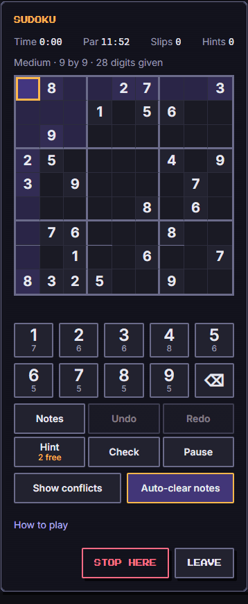
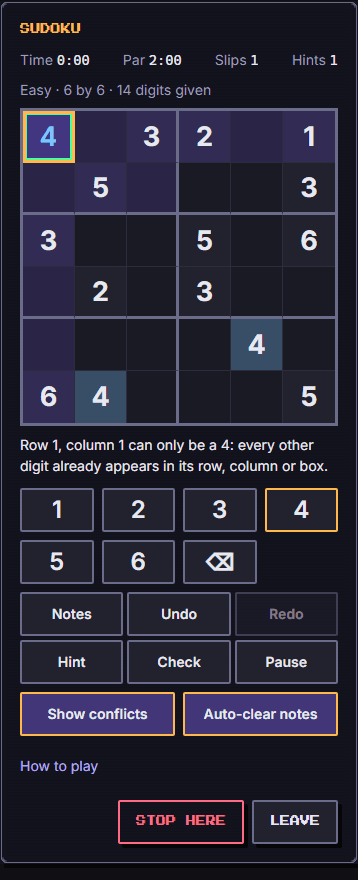
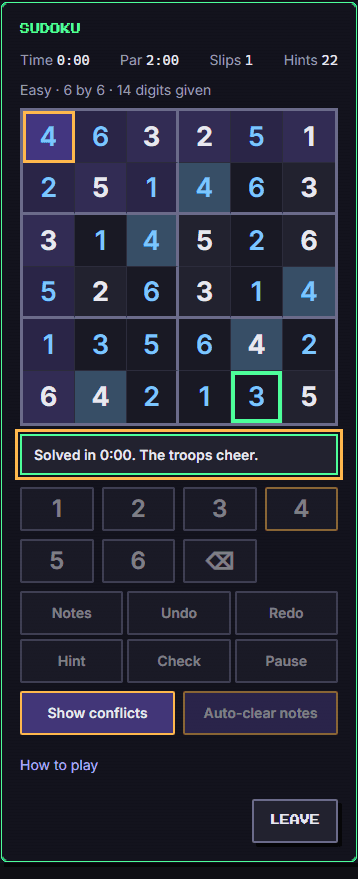

# Sudoku (`sudoku`)

The classic number-place puzzle with a generator that proves every grid has exactly one solution and grades it by the hardest technique a person needs. Small 6x6 boards for the first two difficulties, the full 9x9 board from the third. You cannot lose: a solved grid is a win, stopping early keeps a partial score and the troops come home.

Category `puzzle`, minimum ring 1, roster 1 to 8, about 5 minutes.

| Start | Playing | Solved |
| --- | --- | --- |
|  |  |  |

## How to play

Fill the grid so that every row, column and box holds each digit once (1 to 6 on the small board, 1 to 9 on the full one; small boxes are 2 rows by 3 columns, full boxes 3 by 3). Some digits are given and cannot change.

- **Select** a cell (tap, click or arrow keys), then **place** a digit with the pad or the keyboard. Pressing the digit a cell already holds clears it.
- **Notes** (pencil marks): the Notes switch (or N, or Shift plus a digit) turns digits into small notes. Placing a digit in a cell clears that cell's notes.
- **Erase**, **Undo** and **Redo** are unlimited and exact (they restore the digits and the notes). Slips, hints and checks that were counted stay counted.
- **Hint** fills the next cell a person could fill and says why in the live line ("Row 3, column 5 can only be a 7: every other digit already appears in its row, column or box." or "In row 4, a 2 fits in only one cell"). If a digit you typed is wrong, the hint points at it instead.
- **Check** marks every wrong digit you typed (a cross in the corner, "marked wrong" in the cell's name) until you change that cell.
- **Show conflicts** underlines equal digits that share a row, column or box. It is on at difficulty 1 to 3 and off above, and you can switch it any time.
- **Pause** stops the clock and hides the board. **Stop here** ends the game as `fled` and keeps showing the board; **Leave** is a separate button that closes the screen.
- Time counts real seconds (one `second` action per second). The par time is the speed target.

Keyboard: arrows, Home and End move; 1 to 9 place (or note); 0, Backspace and Delete erase; N toggles notes; H hint; Ctrl+Z undo; Ctrl+Y or Ctrl+Shift+Z redo. Space and Enter press whatever button has focus.

Every cell is named "Row 3, column 5, box 2: 7, given" or "...: empty, notes 1 4" (and ", marked wrong", ", conflicts with another 7"). Moving focus reads the name; placing, erasing, notes, undo, redo, hints, checks and the end are announced in a polite live region.

## Generation and difficulty

`generate(seed, geo, grade)` in `generator.ts`:

1. A full valid grid by seeded randomised backtracking (always the empty cell with the fewest candidates, digits in a seeded order).
2. Clues are removed in a seeded order. A removal is kept only if the exact counter (`countSolutions`, up to two) still finds exactly **one** solution and, for the easy and medium tiers, the technique ladder can still solve the puzzle without going above that tier's ceiling.
3. The puzzle is graded by the hardest technique the ladder needs. If the grade is below the request, the next derived seed is tried (at most 12 attempts, `sudoku:<seed>:<size>:<attempt>`). If every attempt falls short the best puzzle is returned with its **true** grade, never a relabelled one.

The technique ladder (always easiest first, so the grade is what the puzzle truly needs):

| Technique | Grade | What it does |
| --- | --- | --- |
| Naked single | easy | A cell with one candidate left. |
| Hidden single | medium | A digit with one possible cell in a row, column or box. |
| Naked pair | medium | Two cells of a unit with the same two candidates remove them from the rest of the unit. |
| Locked candidates | hard | Pointing (a digit confined to one line inside a box leaves the line) and claiming (confined to one box inside a line leaves the box). |
| Guess | hard | The ladder is stuck: the answer must be found by trying. Hints give the answer and say so. |

| Difficulty | Board | Grade asked | Clues kept (min / mean / max over 200 seeds) | Clue floor |
| --- | --- | --- | --- | --- |
| 1 | 6x6 | easy (naked singles only) | 14 / 14.0 / 14 | 14 |
| 2 | 6x6 | medium (needs a hidden single or pair) | 9 / 9.9 / 12 | 9 |
| 3 | 9x9 | easy (naked singles only) | 34 / 34.0 / 34 | 34 |
| 4 | 9x9 | medium | 28 / 28.0 / 29 | 28 |
| 5 | 9x9 | hard (locked candidates or a guess) | 24 / 24.8 / 28 | 24 |

The easy tiers stop at their clue floor (naked singles could go lower; the floor keeps them gentle). The 6x6 board is too small for most puzzles to need locked candidates, so a 6x6 **hard** grade is not offered by the game; `generate` accepts it as best effort and returns the true grade (about half the seeds reach hard).

Measured over seeds 1 to 200: every puzzle in the five offered tiers has exactly one solution, a valid solution, at least one blank, and a grade at least the one asked for (asserted in `engine.test.ts`). Work is bounded by operation counts, not wall time: solver nodes and ladder steps per `generate` call, at most `OPS_CAP` = 400,000 as a safety stop; measured worst cases 670 (6x6 easy), 11,000 (6x6 medium), 2,700 (9x9 easy), 13,000 (9x9 medium) and 90,000 (9x9 hard), mean 19,000 for hard, about 8 ms in Node.

## Scoring

Score 0 to 1000, integer maths only.

- **Solved** (`won`): `600` base + speed bonus (0 to 250) + accuracy bonus (`150 - 25 per slip`, never below 0), then minus the cost of hints and checks, clamped to 0..1000.
- **Speed bonus:** 250 up to half the par, 0 from twice the par, linear between (`floor(500 * (2 * par - seconds) / (3 * par))`).
- **Slip:** a wrong digit placed (counted once when placed, kept when undone). The digit stays on the board, because the game is relaxing.
- **Hint:** 20 points, 5 when it is one of the free hints (Study, hint buff). **Check:** 10 points, the first is free with Hygiene.
- **Stopped early** (`fled`): `floor(500 * blanks filled right / blanks) - 10 per slip - hint and check costs`, never above 500, so any win beats any early stop.
- The par is `PAR_SECONDS[difficulty]` (120, 180, 360, 540, 780 s) plus the Sleep and time bonuses below.

`outcome.stats` carries `grade`, `size`, `seconds`, `par`, `mistakes`, `hints`, `checks`, `clues`, `blanks`, `filled`. The log has the time, the par, slips, hints and checks, and the technique used most. `learned` (on a win) is one sentence about that technique (naked single, hidden single, or deeper elimination), in English and French.

## Party

Every member is listed in `troopsUsed` (they sit around the table). The habits that change play:

| Habit | Effect |
| --- | --- |
| Study | One free hint; a second free hint from power 24. |
| Sleep | Adds par time: `10 + floor(power / 2)` percent of the par, at most 60 (power 44 gives +32 percent). |
| Clean | Impossible notes clear themselves when a digit is placed (a switch, on by default; switching it on also removes the notes that are already impossible). |
| Social | The pad shows how many of each digit are still to place. |
| Hygiene | The first check is free (costs no points). |

Other habits (move, outside, eat) have no effect on this game; a member with no habit changes nothing and still takes part. A level 12 party therefore plays with two free hints, a par a third longer, auto-cleaning notes and digit counts, where a new party (move, outside, clean) only has clean notes. The game is playable with any party, from one member to eight.

## Buffs

| Kind | Effect |
| --- | --- |
| `hint` | `amount` more free hints (cost 5 points instead of 20). |
| `time` | `amount` seconds added to the par. |
| `luck` | The puzzle is regenerated once, gentler: `min(4, 1 + floor(amount / 10))` more digits are revealed, taken first from the cells the ladder had the most trouble with. The solution stays the same and unique, and the shown grade is recomputed. |
| `attack`, `defense`, `revive` | Ignored: there is no combat and you cannot lose. |

## Determinism and the bot

`initial(seed, party, run, locale)` is pure: the puzzle depends on the seed and the difficulty (luck adds digits). Nothing reads a clock; time is the `second` action. `botPlay` solves by the ladder (naked, hidden, pair, locked), spends a free hint when only a locked or guess step is left, and lets seconds pass at 85 percent of the base par over a whole grid, so its games are timed too (its score depends on the party and the buffs). It always finishes and always replays identically.

Bot over 100 seeds per difficulty (`parties.full` / `parties.starter`): won 100/100 at every difficulty; mean score 979 / 947 (d1), 979 / 946 (d2), 978 / 944 (d3), 977 / 944 (d4), 969 / 944 (d5); 120 to 709 actions per game. A person is not a bot: the point of the game is the puzzle, not a win rate.

## Tuning numbers

`SCORE` (base 600, speed 250, accuracy 150, slip 25, hint 20, free hint 5, check 10, partial 500, partial slip 10), `PAR_SECONDS`, `BOT_PACE_PERCENT` (85) in `engine.ts`; `CLUE_FLOOR`, `MAX_ATTEMPTS` (12), `OPS_CAP` in `generator.ts`.

## Known limits

- The 9x9 cells are about 28 px wide at 320 px (about 35 px at 390 px): a 44 px target is physically impossible for nine columns on a small phone. The cells are not `<button>`s but ARIA grid cells; the number pad, the tools and every control are at least 44 px, and the usual play is "pick a cell, tap a digit". The 6x6 board has cells of about 42 px.
- Notes are small (9 to 11 px) on the 9x9 board at 320 px.
- A hard puzzle may need a guess; the ladder has no X-wing or chains. The hint then says plainly that nothing simpler is left.
- The 6x6 hard grade is best effort (see above).
- The clock counts real time while the tab is visible; a hidden tab pauses it.
