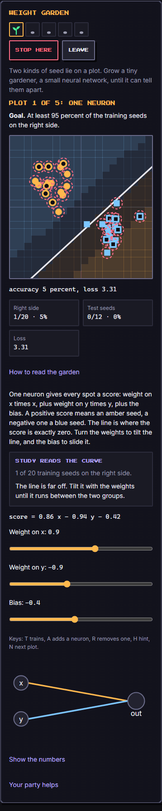
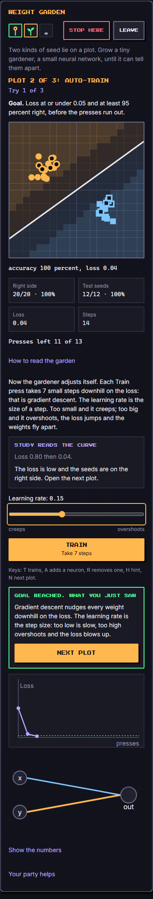
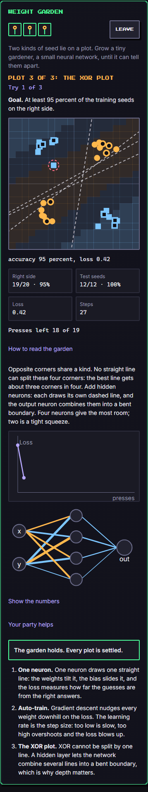

# Weight Garden (`weight-garden`)

A garden plot holds two kinds of seed, amber circles and blue squares. You grow a tiny "gardener", a small neural network, until it can tell them apart. On each plot you see the network's weights, the line (or bent boundary) it draws, its loss and its accuracy, and you change one thing at a time: turn the weights by hand, pick a learning rate and train, add hidden neurons, stop before it memorises. It is a short, forgiving learning game: a failed game is "the garden wilts for now, the troops come home to rest", never a punishment.

Category `ai-learning`, minimum ring 2, roster 1 to 8, about 4 minutes. Learning goal: how a neural network learns (weights and bias, decision boundary, loss, learning rate, why a hidden layer is needed, overfitting and early stopping).

| Start | Training | Settled |
| --- | --- | --- |
|  |  |  |

## How to play

Five plots, in order (fewer on low difficulty: 3 at difficulty 1, 4 at difficulty 2, 5 from 3). Each plot has a goal; when it is met a **What you just saw** card with one sentence appears and **Next plot** opens the next. Next plot is refused until the goal is met.

| Plot | What the player does | Goal |
| --- | --- | --- |
| 1. One neuron | Turns three sliders (weight on x, weight on y, bias) by hand and watches the line move and the loss fall. | At least 95 percent of the training seeds on the right side. No limit on moves. |
| 2. Auto-train | Picks a learning rate on a slider and presses **Train** (each press is 4 gradient steps, plus Move's bonus). | Loss at or under a target (about 1.2 to 1.5 times what a well trained neuron reaches on these very seeds, plus 0.02) and 95 percent right, before the presses run out. |
| 3. The XOR plot | Opposite corners share a kind. One neuron cannot do it. Adds 2 to 4 hidden neurons and trains. | 95 percent of the training seeds on the right side. |
| 4. Noise | A few training seeds are mislabelled. Starts with 4 hidden neurons. Watches the train and test curves, settles at the test peak (early stopping) or removes neurons. | A percentage of the hollow **test** seeds right. |
| 5. The ring field | A disc inside a ring. Hidden neurons, a steady rate, and the test seeds. | A percentage of the hollow test seeds right. |

**Tries.** A plot with Train has 3 tries. A try ends when its presses run out without the goal: the gardener is replanted from fresh weights (same size) and the next try begins. After the third failed try the garden wilts (`lost`). A learning rate so high that the loss exceeds 12 ("the weights flew apart") does not cost a try: the gardener is replanted and the press is spent, so experiments with the rate are free of penalty (apart from the press).

**Controls.** Touch or mouse on the sliders and buttons. Keyboard: Tab to a control; sliders take the arrow keys, Home and End. Shortcuts (ignored while typing in a text field): `T` train, `A` add a neuron, `R` remove a neuron, `H` hint, `N` next plot. **Stop here** ends the game as `fled` and keeps the garden on screen (partial score); **Leave** is a separate button that closes the screen.

**Reading the garden.** Solid seeds are training seeds (the gardener learns from them); hollow seeds are test seeds (never trained on, only checked). The tinted background is the gardener's guess, the white line is where a single neuron flips, and on plots with a hidden layer each dashed line is one hidden neuron's own line. A dashed red ring marks a seed on the wrong side. The network is drawn beside the plot (edge thickness is the size of a weight, orange is positive, blue is negative); "Show the numbers" lists every weight. A live line, read aloud by screen readers, says "accuracy 82 percent, loss 0.31" (and the test accuracy on the noise and ring plots). **The gardener says** gives one sentence about what is happening.

**Reduced motion.** Nothing in the game moves on its own; the boundary simply updates after each press. Layout is identical.

**Score** (0 to 1000, whole numbers): 600 times the share of plots settled, plus 250 times the average test accuracy when each plot was settled, plus 150 times the share of presses left over (halved for every extra try). Losing or leaving keeps the score of the plots already settled.

## Concepts, facts and how to verify them

Every fact the game states, and where it is checked. "Unit" means `src/games/weight-garden/engine.test.ts`.

| Concept | What the game says | How to verify |
| --- | --- | --- |
| Weights and bias | One neuron scores a spot with `weight on x times x, plus weight on y times y, plus bias`; positive is one kind, negative the other. The line is where the score is zero; weights tilt it, the bias slides it. | Plot 1: move a slider and watch the equation under it and the line. Unit: "one neuron: output is a x + b y + bias". |
| Decision boundary | The boundary is where the output flips sign; with hidden neurons it is bent. | Plot: the tint flips along the white line; plots 3 to 5 show the bent boundary. |
| Loss | The average squared miss: a seed that should score +1 but scores 0.2 misses by 0.8 and counts 0.64. Lower is better, 0 is perfect. | Unit: "loss is the mean squared miss" (hand computed: 0.015625 and 0.640625). |
| Gradient descent | Training takes small steps downhill on the loss; each weight moves against its gradient. | Unit: forward pass, backward pass (two hand-computed cases on a 2-2-1 net, one through a leaking neuron), the gradient equals the slope measured by central differences, and one step moves each weight by `rate times gradient`. |
| Learning rate | Too small and it creeps; too big and it overshoots, the loss jumps and the weights fly apart. | Unit: rate 0.01 never reaches the goal within the presses on 20 of 20 seeds while 0.2 does; rate 3 diverges in one press. Measured on the auto-train plot at difficulty 3 over 30 seeds: 0.01 passes 0, 0.03 passes 2, 0.1 passes 27, 0.2 and 0.5 pass 30, 1.0 oscillates (8 pass), 1.5 and above diverge on all 30. |
| One line cannot do XOR | The best line gets about three corners in four. | Unit: one neuron trained 1500 steps on 25 XOR plots never passes 80 percent (measured best: 65 percent, mean 53 percent). |
| A hidden layer bends the boundary | Each hidden neuron draws its own line; the output combines them. | Unit: hidden-layer forward pass by hand; XOR with four hidden neurons reaches 95 percent on at least 32 of 40 seeds in 120 steps (measured 34; three neurons 31; two neurons only 11). The dashed lines on the plot are the hidden neurons' own lines. |
| More neurons, more room | Four neurons give the most room; two is a tight squeeze. | The measurements above. |
| Overfitting | A big network memorises noisy training seeds: training accuracy keeps climbing while test accuracy falls. | Unit: a 4-neuron net on the noise plot, early (40 steps) against late (3000 steps), over 30 seeds: training accuracy rises and mean test accuracy falls by more than 4 points (measured about 84 percent then 77 percent). The accuracy curves show it live. |
| Early stopping and smaller networks | Settle at the peak of the test curve, or remove neurons. | Unit: on 90 percent of 40 noise plots a single neuron already reaches the plot goal on the test seeds; the bot removes neurons when training accuracy runs 8 points ahead of test accuracy. |
| Held-out test seeds | Test seeds are never trained on. | Unit: training with and without the test seeds gives identical weights. |

## Party

The gardener works with any party; the habits shape how it learns.

- **Move** (power of the party's Move vassals): one extra gradient step in every Train press per 12 power, at most 4 (a level 12 Move vassal, power 44, gives +3). Flavour: speed.
- **Sleep** (power of the Sleep vassals): one extra press on every try per 12 power, at most 5 ("rest consolidates learning"). A level 12 Sleep vassal gives +3 presses.
- **Study**: with a Study troop the gardener reads the loss and accuracy curves for you: the advice line ("The loss went up. The steps are too big and overshoot: lower the rate.") appears under **Study reads the curve**. Without it you get the plain numbers and are told to read the curve yourself; the curves, the numbers and the "How to read the garden" text are always there.
- Other habits and titles do not change the rules. The troops credited in the outcome are the Move, Sleep and Study troops that helped (or the first member when none did).

A starter party (three level 1 vassals: Move, Outside, Clean) gets +0 steps and +0 presses; a full level 12 party gets +3 steps and +3 presses (and the Study advice), which moves the bot's win rate on difficulty 3 from about 55 to about 77 percent.

## Buffs

- `time`: one extra press per 10 seconds of buff (20 seconds is +2 presses on every try).
- `hint`: the amount is the number of hints. A hint (button or `H`) sets a kind learning rate and shows a tip for the plot; on plot 1 it draws a dashed suggested line. One hint per plot.
- `luck`: the gardener sprouts from the healthiest of `1 + amount / 5` random seedlings (the one with the lowest loss after a short trial run), also when a neuron is added or the gardener is replanted.
- `revive`: each unit is one extra try, kept in reserve and used when a plot's third try fails.
- `attack` and `defense` are ignored: nothing in a garden is attacked or defended.

## Tuning numbers

Difficulty 1 to 5. The number of plots is 3, 4, 5, 5, 5.

| Plot | Steps per press | Presses per try (d1 to d5) | Start rate | Goal (d1 to d5) |
| --- | --- | --- | --- | --- |
| Auto-train | 4 | 10, 9, 8, 7, 6 | 0.02 | loss target factor 1.5, 1.4, 1.3, 1.2, 1.15 and 95 percent |
| XOR | 10 | 16, 14, 12, 12, 10 | 0.15 | 95 percent |
| Noise | 12 | 12, 12, 12, 11, 10 | 0.25 | test 78, 82, 84, 86, 87 percent |
| Ring | 12 | 14, 12, 9, 9, 8 | 0.25 | test 82, 86, 90, 92, 95 percent |

Seeds scattered on a plot spread more and sit closer as difficulty rises; the noisy plot mislabels 2 of its 12 training seeds (3 from difficulty 3) and is re-drawn up to 24 times until a plain line reaches its goal on the test seeds. Learning rates offered: 0.01, 0.02, 0.03, 0.05, 0.07, 0.1, 0.15, 0.2, 0.25, 0.3, 0.4, 0.5, 0.7, 1, 1.5, 2, 3. Hidden neurons: 2 to 4 (a single neuron is "no hidden layer"). Activation: leaky ReLU (slope 0.1 below zero) so no neuron ever dies. Loss: mean squared error on targets of +1 and -1; the guess is the sign of the output. Full-batch gradient descent. Weights are clamped to plus or minus 40 so every number stays finite.

The **bot** (`botPlay`) is a casual competent gardener: it sets the weights from the class averages on plot 1, uses the plot's kind rate, grows 3 hidden neurons on XOR and the ring (4 is more comfortable; a human who picks 4 does better), and on the noise plot removes neurons when training accuracy runs 8 points ahead of test accuracy. Over 100 seeds (starter / full party):

| Difficulty | Wins | Mean score |
| --- | --- | --- |
| 1 | 99 / 100 percent | 956 / 966 |
| 2 | 100 / 100 percent | 954 / 965 |
| 3 | 55 / 77 percent | 873 / 914 |
| 4 | 42 / 71 percent | 847 / 901 |
| 5 | 25 / 41 percent | 811 / 858 |

On difficulty 3 the bot settles the first four plots on 98 of 100 seeds with the starter party.

## Determinism and honesty

Only addition, subtraction, multiplication, division, comparison and `Math.sqrt` are used (no `exp`, `tanh` or fractional powers), and every random choice comes from the seeded generator, so a seed replays identically on every device. The game runs on the device with no network.

## Known limits

- It is a toy: two inputs, at most four hidden neurons, a few dozen seeds. Real networks have far more of everything; the ideas are the same.
- Classification here uses a squared-error loss on targets of +1 and -1 and the sign of the output. Most real classifiers use cross-entropy; squared error keeps the numbers easy to read.
- The noise plot shows training accuracy rising and test accuracy falling, but a four-neuron network does not reach 100 percent on its training seeds (about 85 to 90 percent), so the picture is "memorising some of the noise", not perfect memorisation.
- Training is full-batch gradient descent with a constant rate; momentum, schedules and mini-batches are not shown.
- Two neurons can solve XOR but often get stuck from a random start; the game says so but the exact odds (11 of 40 in 120 steps) depend on the initialisation used here.
- The Study troop changes what is explained, not the rules, so it does not change the bot's results.
- The two-column layout appears on wide or short-and-wide screens only; in a narrow frame the garden is a single column that scrolls.
