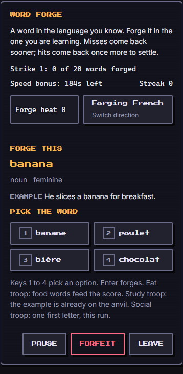
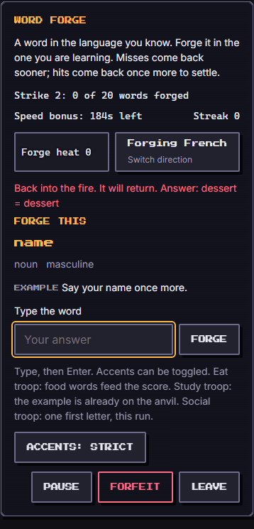
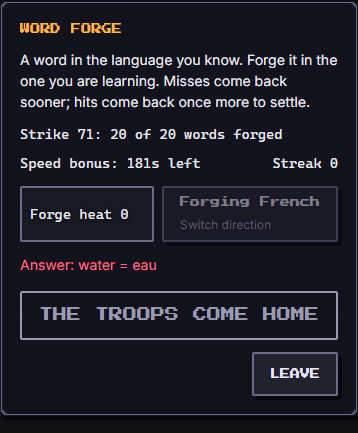

# Word Forge (`word-forge`)

A forge turns words into steel. A card shows a word in the language you know; you forge the matching word in the language you are learning. The target language is the other one (English app: French words; French app: English words), and you can switch direction during a run. Misses come back sooner, hits come back once more: a tiny spaced-repetition scheduler inside about three minutes. It is practice, not a test: a run that goes badly is "the troops come home", and the steel will wait.

| Field | Value |
| --- | --- |
| Category | self-development |
| Minimum ring | 1 |
| Roster | 1 to 8 |
| Length | about 3 minutes |
| Learning | second-language vocabulary (spaced repetition, A2 to B1) |

## How to play

A run draws **20 unique words** from the decks below. Each word is shown, then scheduled again:

- a wrong answer returns after **2** further cards, then after **5** if it is missed again;
- a first right (or "almost") answer returns once more after **8** cards (after **6** with a Study troop) for a final check;
- a word is finished after that final check, or after four shows (the game is always bounded).

| `run.difficulty` | Input | Accents (default) | Decks |
| --- | --- | --- | --- |
| 1 | four options | n/a | food and drink |
| 2 | four options | n/a | food, travel |
| 3 | typed | flexible | food, travel, work |
| 4 | typed | strict (toggle available) | all four |
| 5 | typed | strict (toggle available) | all four, biased toward longer words |

**Controls.** Touch: tap an option, or type and press **Forge**. Keyboard: `1` to `4` pick an option; on typed cards the field is focused for you, so you type and press Enter (no mouse needed). **Pause** stops the clock and hides the card (so it cannot be read for free). **Forfeit** ends the game as `fled` and keeps the board on screen; **Leave** is a separate button. After every answer a live line says what happened and shows the answer (`Answer: water = eau`), so a miss always teaches the word.

**Reduced motion:** the forge sparks are left out; the heat bar and the streak number stay.

### Score and result

- **Word credit.** The final answer of each word counts: right 1, "almost" 0.5, wrong 0. A word that needed the forge again (at least one miss) is worth **0.6 of** its final credit. Accuracy is the sum over the 20 words divided by 20.
- **Score (0 to 1000)** = 700 x accuracy + up to 150 for the best streak (10 in a row is full marks) + up to 150 for speed (seconds left of a par of 180 s plus the `time` buff plus `floor(average party power / 11)`) + the Eat bonus below. Speed is a bonus, never a deadline: running past par only loses the speed points.
- **Result.** `won` at 70 percent accuracy or better, `lost` below, `fled` on forfeit.
- **`learned`.** The three hardest words of the run (most misses first), with English and French, and a vocabulary takeaway.

### Answer checking (typed cards)

The checker is exact and tested (`gradeTyped` and `normalizeAnswer` in `engine.ts`):

1. Unicode NFC.
2. Trim, collapse runs of white space to one space, lower case.
3. Fold apostrophes (the curly quotes, the modifier apostrophe and the backtick) to `'`, and every dash variant (hyphen, non-breaking hyphen, en and em dash, minus) to `-`.
4. Fold the ligatures `œ` and `æ` to `oe` and `ae` always (they are not accents and are hard to type: `oeuf` is right for `œuf`, in strict mode too).
5. If accents are flexible: decompose (NFD) and strip combining marks, so `cafe` is right for `café`.
6. Equal: **right**. Otherwise **almost** (half credit) when, in strict mode, only accents differ (`eleve` for `élève`), or when the expected word has at least 3 characters and the edit distance is 1 (`pommes` for `pomme`, `week end` for `week-end`). Everything else is wrong. An empty answer is wrong.

The accent toggle is a button on typed cards; difficulty 3 starts flexible, 4 and 5 start strict.

## Decks

Four decks of 40 words at about A2 to B1 level, 160 entries, in `words.ts`. Each has the English word, the French word, a part of speech, a gender tag for French nouns (`m` or `f`; `n` for non-nouns and the epicene nouns *collègue* and *enfant*), and a short original example sentence in each language (`examples.ts`, loaded with the Screen only).

- **Food and drink**: food, meals, the kitchen. Cognates (same spelling, on the allow-list): orange, dessert, restaurant, sandwich.
- **Travel and places**: transport, places, directions, landscape. Cognates: train, bus, village, taxi.
- **Work and study**: school, the desk, language. Cognate: question.
- **Feelings and people**: moods, family, greetings. Cognate: parent.

Tests check: four decks of 40; unique ids; no repeated English or French entry; both sides non-empty, trimmed, lower case and NFC; identical sides only for the allow-listed cognates; a gender on every French noun except the listed epicene ones; an example in both languages for every word; no ambiguous or spelling-variant English entry (no *left*, *right*, *neighbour*, ...).

### Review of the translations (second pass)

Every one of the 160 pairs was read again as a single-answer card: if two answers could be right, the word was dropped. Words replaced in the second pass, and why:

| Dropped | Why | Replaced by |
| --- | --- | --- |
| *left* / *gauche*, *right* / *droite* | "right" also means correct and "left" is a past tense: two valid answers | *crossroads* / *carrefour*, *boat* / *bateau* |
| *river* / *rivière* | French splits *rivière* (flows into another river) and *fleuve* (into the sea) | *lake* / *lac* |
| *weekend* / *week-end* | the two spellings differ only by a hyphen, unfair to type | *plane* / *avion* |
| *student* / *élève* | a student is usually *étudiant*; *élève* is a school pupil | *student* / *étudiant* |
| *email* / *e-mail* | the same spelling problem as week-end | *printer* / *imprimante* |
| *neighbour* / *voisin* | British spelling: a typed *neighbor* would be marked wrong | *visitor* / *visiteur* |
| *please* / *s'il te plaît* | *s'il vous plaît* is just as right | *welcome* / *bienvenue* |
| *angry* / *fâché* | *fâché* is closer to "upset"; *en colère* is the plain match | *angry* / *en colère* |

Doubtful entries kept, with the reason they stay: *gare* for "station" (the train station), *partir* for "leave" (depart), *cours* for "class", *pause* for "break", *date limite* for "deadline", *professeur* for "teacher" (masculine dictionary form, used for anyone), *effrayé* for "scared" (*apeuré* also exists; *effrayé* is standard), *gens* tagged masculine (a plural noun, listed as `people`), and *désolé*, *heureux* and the other adjectives in the masculine citation form (the feminine form typed by a learner is "almost", one letter off). The deck has no false friend (*library* is *bibliothèque*, not *librairie*). Nothing was kept on a guess: when unsure, the word is not in the deck. A native-speaker read of the list before release is still welcome (see known limits).

## Party

Every member stands at the forge (`troopsUsed` is the whole fitted party, 1 to 8). What the habits do, in play:

- **Study**: the example sentence (in the language you know) is shown on every card, and the "right" review gap shortens from 8 to 6 cards, so the final check comes sooner.
- **Social**: on typed cards, the first letter of one card is revealed for free, once per game.
- **Eat**: food-deck words are three times more likely to be drawn, and every fully correct food word adds `5 + floor(Eat power / 10)` points.
- **Power**: the average party power adds `floor(power / 11)` seconds to the speed par (a level 12 party: +4 s).

`parties.starter` (Move, Outside, Clean) has none of those habits, so a first-time player gets a fair forge without the extras. The bot uses the Study example too (+0.03 hit rate), so a fuller party wins measurably more often: see the table. Titles (`traits`) are not used.

## Buffs

- `hint`: each point is one press that reveals the first letter of the current word.
- `time`: each point is one extra second on the speed par.
- `revive`: each point forgives one miss in the streak (the word still comes back, and still counts as missed for the score).
- `luck`: percentage points; that share of the 20 cards is swapped for a shorter, easier word.
- `attack` and `defense` are ignored: there is no combat in a forge.

## Tuning numbers

| Number | Value |
| --- | --- |
| Words per run | 20 |
| Miss returns | after 2 cards, then 5 |
| Right returns | after 8 cards (6 with Study) |
| Max shows per word | 4 |
| Recovered word factor | 0.6 |
| Win at | 70 percent accuracy |
| Score split | 700 accuracy, 150 streak, 150 speed, plus the Eat bonus |
| Speed par | 180 s + `time` + `floor(avg power / 11)` |
| Bot hit rate by difficulty 1 to 5 | 0.80, 0.62, 0.50, 0.47, 0.41 (+0.03 with Study) |

Bot wins over seeds 1 to 100 (English app, no buffs):

| Difficulty | Full party | Starter party |
| --- | --- | --- |
| 1 | 100 | 100 |
| 2 (the plain run) | 62 | 47 |
| 3 | 60 | 53 |
| 4 | 47 | 36 |
| 5 | 24 | 13 |

## Determinism

Setup uses `mulberry32(fnv1a('word-forge:<seed>'))`. Option shuffles use `turnRng(seed, marks.length)`, so the one-second clock cannot change the card order, and the same seed, party, run and locale replay identically. The locale picks the target language (the card order does not depend on it). The kit's bot stream does not depend on the seed, so `botPlay` mixes in a per-card stream derived from the game seed: different games miss different cards, a replay misses the same ones. The only wall-clock input is the coarse `second` action that the Screen sends once per real second (speed bonus).

## Known limits

- English entries use one accepted spelling each; a typed alternative spelling (for example a US variant) is marked wrong, which is why such words are not in the decks.
- French adjectives are in the masculine singular citation form; the feminine form is "almost".
- The translations were reviewed twice by the author but not by a native speaker.
- There is no timer pressure beyond the speed bonus, and no word memory between games (games store nothing; the host stores outcomes).

## Screenshots

Written by `e2e/games/word-forge.spec.ts` (`shootGame`, mobile project).

| Start | Typed card after a miss | End |
| --- | --- | --- |
|  |  |  |
